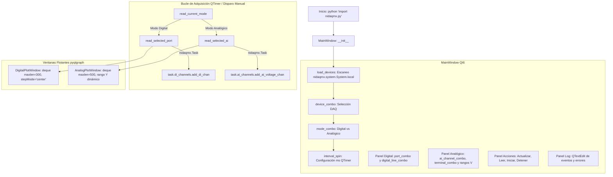

# `pruebas/import nidaqmx.py` — Contexto Técnico para Agentes IA

> Aplicación gráfica de instrumentación y adquisición de datos en tiempo real (Qt6/PySide6) para hardware National Instruments (NI-DAQmx), con visualización desacoplada de estados digitales (curvas escalonadas) y voltajes analógicos (RSE, NRSE, DIFF) mediante `pyqtgraph`.

**Ruta**: `c:/proyectos/rsa_sismologia/pruebas/import nidaqmx.py`  
**LOC**: 604 | **Lenguaje**: Python 3.13.11  
**Entorno de Ejecución**: `C:\entornos\estructuras`  
**Dependencias Clave**: `nidaqmx` (1.4.1), `PySide6` (6.10.2), `pyqtgraph` (0.14.0), `numpy` (2.4.3)  
**Ejecución**: Standalone GUI (`& "C:\entornos\estructuras\Scripts\python.exe" "pruebas/import nidaqmx.py"`)  

---

## 1. Identidad, Alcance y Propósito

`pruebas/import nidaqmx.py` es una herramienta de laboratorio y pruebas de instrumentación desarrollada para validar la adquisición de datos de sensores y tarjetas DAQ de National Instruments en entornos industriales/estructurales.

### Objetivos Clave:
1. **Detección Automática de Hardware**: Inspección dinámica de dispositivos conectados vía `nidaqmx.system.System.local()`.
2. **Doble Modalidad de Operación**:
   * **Modo Digital**: Lectura de puertos completos (`LineGrouping.CHAN_FOR_ALL_LINES`), desglose a nivel de bits (líneas individuales `0` y `1`) y graficación escalonada en ventana independiente.
   * **Modo Analógico**: Lectura de canales analógicos individuales (`aiX`) con configuración de terminales seleccionable (`RSE`, `NRSE`, `DIFF`) y límites de rango de tensión ajustables.
3. **Monitoreo Continuo y Manual**: Soporte de lectura puntual (un solo disparo) o adquisición periódica sincronizada mediante `QTimer` (intervalo de 50 a 5000 ms).
4. **Visualización Gráfica en Ventanas Separadas**: Uso de `pyqtgraph` para bajo consumo de CPU durante el refresco en tiempo real mediante buffers circulares (`collections.deque`).

---

## 2. Arquitectura de Componentes y Flujo de Datos

---

## 3. Entorno de Ejecución y Dependencias de Hardware

### 3.1. Entorno Virtual Dedicado
* **Ruta**: `C:\entornos\estructuras`
* **Python**: Versión `3.13.11`
* **Intérprete**: `C:\entornos\estructuras\Scripts\python.exe`
* **Paquetes críticos**:
  * `nidaqmx==1.4.1`: Wrapper de la API C NI-DAQmx. Requiere los drivers de NI-DAQmx instalados en el sistema operativo Windows.
  * `PySide6==6.10.2`: Bindings oficiales de Qt6.
  * `pyqtgraph==0.14.0`: Graficación científica en tiempo real.

### 3.2. Hardware Soportado
* Cualquier dispositivo DAQ reconocido por el subsistema NI-DAQmx (chasis cDAQ, módulos de las series USB-6008, USB-6009, PCIe-63xx, etc.).
* En ausencia de hardware físico, el software es compatible con dispositivos simulados creados desde el software **NI MAX** (Measurement & Automation Explorer).

---

## 4. Clases, Componentes y Métodos Principales

| Clase | Tipo | Responsabilidad / Métodos Principales |
|---|---|---|
| `DigitalPlotWindow` | `QWidget` | **Visor de traza digital**. Mantiene una ventana flotante con `pg.PlotWidget`. • `add_point(value)`: Agrega valor binario a la cola circular (`maxlen=300`) y actualiza la curva con `stepMode="center"`. • `set_channel_name(name)`: Actualiza título/etiqueta. • `clear_plot()`: Reinicia buffer y eje temporal. |
| `AnalogPlotWindow` | `QWidget` | **Visor de traza analógica**. Mantiene una ventana flotante con `pg.PlotWidget`. • `add_point(value)`: Inserta muestra de voltaje en cola circular (`maxlen=500`). • `set_y_range(min, max)`: Ajusta los límites de escala del eje vertical. • `clear_plot()`: Vacía las series de datos. |
| `MainWindow` | `QMainWindow` | **Controlador central e interfaz de instrumentación**. • `load_devices()`: Consulta la lista de dispositivos NI locales. • `on_device_changed()`: Carga puertos digitales y canales analógicos del DAQ activo. • `get_device_ports(device)`: Extrae nombres de puertos (`port0`, etc.) y número de líneas. • `get_ai_channels(device)`: Extrae nombres de canales de entrada analógica (`ai0`, `ai1`, ...). • `build_port_state()`: Construye dinámicamente etiquetas con colores (`1 HIGH` en verde, `0 LOW` en rojo) para cada línea. • `read_selected_port()`: Crea tarea efímera `nidaqmx.Task()`, lee valor entero, formatea a binario y despacha a la gráfica. • `read_selected_ai()`: Configura `task.ai_channels.add_ai_voltage_chan`, lee el voltaje y actualiza gráfica y etiquetas. • `start_reading()` / `stop_reading()`: Controla el ciclo del `QTimer`. |

---

## 5. Contratos de Datos y Configuración Técnica

### 5.1. Canales Analógicos y Modos de Terminal
* Modos soportados en `terminal_combo`:
  * `TerminalConfiguration.RSE`: Referenciado a tierra simple (*Referenced Single-Ended*).
  * `TerminalConfiguration.NRSE`: No referenciado a tierra simple (*Non-Referenced Single-Ended*).
  * `TerminalConfiguration.DIFF`: Diferencial (*Differential*).

### 5.2. Estructuras de Memoria en Tiempo Real
* **Buffer digital**: `deque(maxlen=300)` — conserva las últimas 300 muestras discretas.
* **Buffer analógico**: `deque(maxlen=500)` — conserva las últimas 500 muestras de tensión.
* **Sincronización GUI**: Se ejecuta en el hilo principal mediante eventos de `QTimer.timeout`.

---

## 6. Limitaciones Conocidas y Recomendaciones Técnicas

1. **Adquisición por Tareas Efímeras (Polling por Software)**:
   * En cada disparo de lectura (`read_selected_port` o `read_selected_ai`) se crea y destruye un objeto `with nidaqmx.Task() as task:`.
   * *Impacto*: Adecuado para tasas de refresco bajas ($\ge 50$ ms). No es apto para muestreo a alta frecuencia (kHz) o señales continuas de audio/sismología que requieran reloj por hardware (`timing.cfg_samp_clk_timing`).
2. **Ejecución en Hilo Principal**:
   * Las llamadas bloqueantes a `task.read()` ocurren directamente en el hilo de la interfaz de usuario. Si la comunicación con el hardware NI experimenta latencia o timeout, la interfaz Qt podría congelarse momentáneamente.
   * *Recomendación*: Si se requiere muestreo continuo a altas frecuencias, desacoplar la tarea en un hilo trabajador (`QThread`) con lectura por bloques.
3. **Nombre de Archivo con Espacio**:
   * El archivo se titula `import nidaqmx.py`. En invocaciones de consola Windows PowerShell debe ejecutarse entrecomillado: `python "pruebas/import nidaqmx.py"`.
