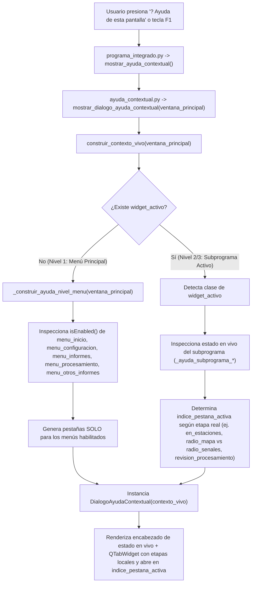

# Contexto Técnico: `src/librerias/ayuda_contextual.py`

> **Actualizado el**: 2026-04-20
> **Estado**: Activo (Motor de ayuda contextual jerárquica y sensible al estado en vivo para `src/programa_integrado.py`)

---

## 1. Propósito y Rol en la Arquitectura

[`ayuda_contextual.py`](file:///c:/Proyectos/rsa_sismologia/src/librerias/ayuda_contextual.py) provee un sistema de **ayuda contextual jerárquica ("ir hacia adentro") y sensible al estado en tiempo real** para toda la suite sismológica `programa_integrado.py`.

A diferencia de un manual estático o de un selector global donde se mezclan pantallas deshabilitadas, este módulo inspecciona en vivo el estado de `VentanaPrincipal` y del subprograma activo al momento de presionar el botón **`?  Ayuda de esta pantalla`**, el menú **`Ayuda -> Guía de esta pantalla`** o la tecla **`F1`**:
1. **Nivel 1 (En la Barra de Menús — `widget_activo is None`)**: Verifica dinámicamente qué menús (`QMenu.isEnabled()`) están habilitados según el modo elegido en `Inicio` y genera pestañas (`QTabWidget`) **exclusivamente para las pestañas del menú habilitadas**, sin mezclar opciones bloqueadas.
2. **Nivel 2 y Nivel 3 (Dentro de un Subprograma Activo — `widget_activo is not None`)**: Entra en el árbol interno del subprograma activo, inspecciona el estado real de sus controles (`isEnabled()`, `isVisible()`, `isChecked()`, `currentText()`, banderas operativas como `en_estaciones` o `revision_procesamiento`) y abre directamente la pestaña de la **etapa o sub-estado exacto en el que se encuentra el operador**, permitiendo además consultar las demás etapas locales de ese mismo subprograma mediante pestañas (`QTabWidget`).

---

## 2. Diagrama de Flujo Operativo (Mermaid)



---

## 3. Contratos de Datos y Estructura del Contexto Vivo

### Diccionario retornado por `construir_contexto_vivo(ventana_principal)`
```python
{
    'ruta_ubicacion': str,          # Ej. 'Procesamiento  ▸  Procesar'
    'subtitulo_estado': str,        # Resumen del estado en vivo detectado (fecha, evento, etapa)
    'indice_activo': int,           # Índice de la pestaña que se selecciona automáticamente al abrir
    'pestanas': [                   # Lista de tuplas (titulo_tab, html_tab)
        (titulo_pestana, html),
        ...
    ]
}
```

---

## 4. Inventario de Funciones y Clases

| Símbolo | Tipo | Responsabilidad |
| :--- | :--- | :--- |
| `_plantilla_html(...)` | Función interna | Construye un documento HTML estilizado con tarjeta de estado en vivo, pasos numerados, referencia de botones/controles y notas técnicas sismológicas. |
| `_construir_ayuda_nivel_menu(ventana_principal)` | Función interna | **Nivel 1**: Inspecciona `isEnabled()` en `menu_inicio`, `menu_configuracion`, `menu_informes`, `menu_procesamiento` y `menu_otros_informes`. Genera pestañas **únicamente** para los menús habilitados en ese instante (Inicio solo, Modo Diario o Modo Periodo). |
| `_ayuda_subprograma_inicio(widget)` | Función interna | **Nivel 2 (`Inicio`)**: Lee en vivo `radioButton_diario` vs `radioButton_periodo`, fecha seleccionada, horario y responsable. |
| `_ayuda_subprograma_marcar(widget)` | Función interna | **Nivel 2 (`Marcar_`)**: Lee en vivo la estación seleccionada (`cmbx_estaciones`) y el número de marcas registradas. |
| `_ayuda_subprograma_extraer(widget)` | Función interna | **Nivel 2/3 (`Extraer_evento`)**: Detecta en vivo cuál de las 3 etapas está activa (`not grupo_evento.isEnabled()` -> Etapa 1 Cargar Marca; `grupo_cortar.isEnabled()` -> Etapa 2 Posicionar y Cortar; `grupo_guardar.isEnabled()` -> Etapa 3 Ajustar Duración y Guardar) y selecciona esa pestaña automáticamente. |
| `_ayuda_subprograma_procesamiento(widget)` | Función interna | **Nivel 2/3 (`Procesar_evento`)**: Detecta en vivo cuál de los 4 sub-estados está activo: **Pestaña 0** (`en_estaciones == False`: Pantalla inicial sin mapas ni estaciones, código de colores Negro/Verde/Rojo y extracción automática de `.sis`), **Pestaña 1** (`en_estaciones == True` + `radio_mapa`: Tabla `estaciones_` + Mapa GIS + `ProcesoV2` Virtual), **Pestaña 2** (`en_estaciones == True` + `radio_senales`: Tabla `estaciones_` + Trazas de señales + botón `Av. Pág`) o **Pestaña 3** (`revision_procesamiento == True`: Revisión obligatoria del PDF de turno `"¡Revise el archivo!"`). |
| `_ayuda_subprograma_fases(widget)` | Función interna | **Nivel 2/3 (`Fases`)**: Documenta la pantalla principal de 4 estaciones (token `EEEECBFFIISS` y pesos HYPO71 `0–4`) y la sub-ventana `VentanaGrafico` al hacer doble clic. |
| `_ayuda_subprograma_otras_redes(widget)` | Función interna | **Nivel 2 (`Otras_redes`)**: Detecta en vivo `widget.red` (`IGEPN` 13 columnas vs `USGS` 21 columnas) y muestra la guía correspondiente. |
| `_ayuda_subprograma_reporte_diario(widget)` | Función interna | **Nivel 2/3 (`Reporte_diario`)**: Documenta el flujo de auditoría y generación de informes diarios (`M2`) y la sub-ventana `Calidad de Estación`. |
| `_ayuda_subprograma_reporte_periodo(widget)` | Función interna | **Nivel 2/3 (`Reporte_periodo`)**: Detecta en vivo si ya se recopiló un periodo (`Btn_guardar.isEnabled()`), lee `cmbx_zona`, `ck_box_reporte`, `ck_box_firma` y `ck_box_relleno`, e invoca `resolver_modo_por_zona` y `derivar_banderas_desde_modo` para mostrar en tiempo real el modo exacto (`M0`, `M3`–`M7`) y las banderas PDF que se imprimirán. |
| `_ayuda_subprograma_reporte_enjambre(widget)` | Función interna | **Nivel 2/3 (`Reporte_enjambre`)**: Documenta las 3 zonas operativas (Período en Días, Lugar Geométrico y Mapa GIS Interactivo, y Condiciones del Informe PDF en ReportLab) leyendo en vivo el rango de días, el tipo de lugar geométrico y los conteos de sismos filtrados. |
| `construir_contexto_vivo(ventana_principal)` | Función pública | Punto de entrada de introspección: decide si construir la ayuda de Nivel 1 (menús habilitados) o Nivel 2/3 (subprograma activo y su etapa interna). |
| `DialogoAyudaContextual` | Clase (`QDialog`) | Ventana modal con encabezado dinámico (ruta jerárquica + estado actual detectado), `QTabWidget` con las pestañas del contexto activo (`QTextBrowser` por pestaña) y botón de cierre. |
| `mostrar_dialogo_ayuda_contextual(ventana_principal)` | Función pública | Construye el contexto en vivo y ejecuta `DialogoAyudaContextual`. |

---

## 5. Riesgos Conocidos e Invariantes

1. **Tolerancia a Fallos de Introspección**: Todas las lecturas de atributos de `ventana_principal` y `widget_activo` utilizan `getattr(..., None)` y bloques `try/except` para garantizar que la ayuda jamás lance una excepción aunque algún widget interno cambie de estado o aún no haya sido inicializado.
2. **Aislamiento de Interfaz**: `ayuda_contextual.py` es estrictamente de **solo lectura** sobre `ventana_principal` y `widget_activo`; nunca modifica estados, banderas ni señales de los subprogramas sismológicos.

---

## 6. Checklist de Regresión

- [ ] Al iniciar el programa (solo menú `Inicio` habilitado), presionar `?  Ayuda de esta pantalla` o `F1` muestra únicamente la pestaña **`Pestaña: Inicio`** y explica que las demás pestañas están deshabilitadas hasta configurar el modo.
- [ ] En Modo **Diario** en el menú principal (`widget_activo is None`), la ayuda muestra únicamente las pestañas habilitadas: **`Pestaña: Procesamiento`**, **`Pestaña: Otros Informes`** y **`Pestaña: Inicio`**.
- [ ] En Modo **Periodo** en el menú principal (`widget_activo is None`), la ayuda muestra únicamente las pestañas habilitadas: **`Pestaña: Configuración`**, **`Pestaña: Informes`** y **`Pestaña: Inicio`**.
- [ ] Dentro de `Procesamiento -> Procesar` antes de escoger un evento (`en_estaciones == False`), la ayuda abre automáticamente en la **Pestaña 1 (`Selección de Evento`)** explicando por qué el área derecha está en blanco y qué significan los colores Negro/Verde/Rojo.
- [ ] Dentro de `Procesamiento -> Procesar` tras hacer clic en `Procesar` (`en_estaciones == True`), la ayuda abre automáticamente en la **Pestaña 2 (`Estaciones + Mapa`)** si `Mapa` está seleccionado o en la **Pestaña 3 (`Estaciones + Señales`)** si `Señales` está seleccionado.
- [ ] Dentro de `Informes -> Acumulados`, tras recopilar un periodo, la ayuda abre en la **Pestaña 2 (`Mapa, Zona y PDF`)** y muestra en tiempo real el modo (`M0`/`M3`–`M7`) y las banderas PDF exactas según la zona y casillas marcadas en pantalla.
