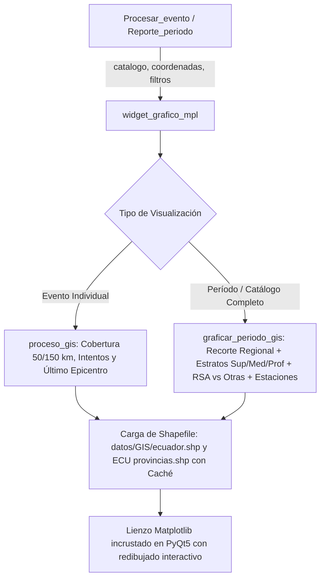

# `src/librerias/metodos_gis_rsa.py` — Contexto Técnico para Agentes IA

> Librería de visualización cartográfica GIS para localización epicentral, evaluación de polígonos de cobertura de la red sísmica (50 km y 150 km), vista previa interactiva de catálogos y períodos e incrustación de mapas en interfaces PyQt5.

**Ruta**: `src/librerias/metodos_gis_rsa.py`  
**LOC**: 600 | **Lenguaje**: Python 3 (GeoPandas, Shapely, SciPy, Matplotlib, PyQt5)  
**Dependencias**: `geopandas`, `shapely.geometry`, `scipy.spatial.ConvexHull`, `numpy`, `matplotlib`, `PyQt5.QtWidgets`, `librerias.metodos_rsa`  
**Proceso**: Importado por `src/subprogramas/procesamiento_integrado.py` (`widget_grafico_mpl`), `src/subprogramas/reporte_acumulado.py` (`graficar_periodo_gis`) y rutinas de reportes cartográficos.

---

## 1. Arquitectura y Flujo Cartográfico

---

## 2. Componentes y Funciones Clave

| Elemento | Firma | Descripción |
|---|---|---|
| `widget_grafico_mpl` | `QWidget(parent=None)` | Contenedor PyQt5 que encapsula `Figure` y `FigureCanvasQTAgg` con márgenes compactos (`2px`) para incrustación en el panel derecho de `Procesar_evento` y en la Zona 5 de `Reporte_periodo`. |
| `_obtener_capas_base_gis` | `()` | Carga y mantiene en memoria caché los shapefiles `ecuador.shp` y `ECU provincias.shp` en `EPSG:4326`, acelerando el redibujado interactivo. |
| `_renderizar_brush_gaussiano_gis` | `(ax, grupos, lon_min, lon_max, lat_min, lat_max)` | Genera una matriz 2D RGBA con pincel radial gaussiano multicapa (*Gaussian Airbrush*) y saturación exponencial $1 - e^{-S}$ para visualizar nidos sísmicos mediante `ax.imshow` cuando `estilo_circulos == 2`. |
| `construir_poligono_lugar_geometrico` | `(definicion_lugar)` | Construye un polígono `shapely.geometry.Polygon` en grados `(lon, lat)` a partir de la definición de lugar geométrico del enjambre (`'circulo'` con corrección geodésica $\cos(\text{lat})$, `'rectangulo'` o `'poligono'`). |
| `graficar_periodo_gis` | `(widget, catalogo, coordenadas_mapa, estilo_circulos, titulo_mapa, parametros_est, mostrar_estaciones, poligono_enjambre=None)` | Renderiza en el lienzo embebido el catálogo filtrado del período, clasificando por estrato (Superficial <40km, Medio 40-70km, Profundo >70km), red (RSA vs Otras), estaciones, simbología (relleno, sin relleno, brush gaussiano) y, si se provee `poligono_enjambre`, superpone el área sombreada y el contorno segmentado azul del lugar geométrico. Retorna diccionario `stats`. |
| `proceso_gis` | `(widget, procesamiento, archivo_estaciones)` | Renderiza el mapa de Ecuador, los anillos de cobertura de 50 km (azul) y 150 km (verde), el historial de intentos (negro), la localización actual (amarillo/rojo) y el cuadro de parámetros hipocentrales. Retorna `(in_gdf_1, in_gdf_2)`. |
| `cobertura_red` | `(archivo, distancia)` | Calcula el polígono convexo (`ConvexHull`) de las estaciones habilitadas y aplica un buffer radial equivalente a `distancia / 110.0` grados en `EPSG:4326`. |
| `catalogo_gis` | `(catalogo)` | Grafica en ventana independiente eventos de múltiples fuentes (`RSA`, `IGEPN`, `USGS`) con simbología diferenciada. |
| `catalogo_gis_` | `(catalogo, indice)` | Renderiza mapa comparativo de un evento local frente a reportes de agencias externas (`IGEPN`, `USGS`). |
| `graficar_catalogo_gis` | `(catalogo)` | Mapa de distribución de eventos categorizados por rangos de magnitud ($<4$, $4\text{–}6$, $\ge 6$). |

---

## 3. Decisiones de Diseño y Ergonomía Visual

1. **Optimización para Pantallas Pequeñas y Paneles Embebidos**:
   * Títulos (`fontsize=8.5, pad=5`), etiquetas de ejes (`fontsize=7, labelpad=2`), numeración de coordenadas (`labelsize=6.5, pad=1`) y márgenes de figura (`subplots_adjust(left=0.10, right=0.98, top=0.92, bottom=0.09)`) calibrados para maximizar el área geográfica útil.
2. **Cuadro de Datos y Estadísticas libre de Solapamiento**:
   * En `proceso_gis`, los parámetros del sismo se renderizan mediante un único bloque multilínea anclado en `(0.98, 0.02)`.
   * En `graficar_periodo_gis`, la caja de conteo estadístico (`Total`, `RSA/Otras`, `Sup/Med/Prof`) se posiciona anclada en `(0.98, 0.02)` sobre el Golfo de Guayaquil / Océano Pacífico, sin solapar la cordillera ni las estaciones.
3. **Simbología Tripartita en Períodos**:
   * `estilo_circulos = True`: Círculos rellenos con opacidad para períodos ordinarios.
   * `estilo_circulos = False`: Círculos sin relleno (circunferencias huecas) para catálogos multianuales densos.
   * `estilo_circulos = 2`: Círculos concéntricos de opacidad difuminada para mapas especiales de fuentes.

---

## 4. Checklist de Verificación y Regresión

- [x] `proceso_gis` retorna la tupla booleana `(in_gdf_1, in_gdf_2)` sin alterar contratos con `Procesar_evento.actualizar_mapa`.
- [x] `graficar_periodo_gis` procesa catálogos con o sin cabecera `Id` y devuelve `stats` con conteos exactos por red y estrato.
- [x] La capa base de shapefiles se cachea en `_CACHE_CAPAS_GIS`, evitando lecturas repetidas de disco durante la navegación o cambios de filtro.
