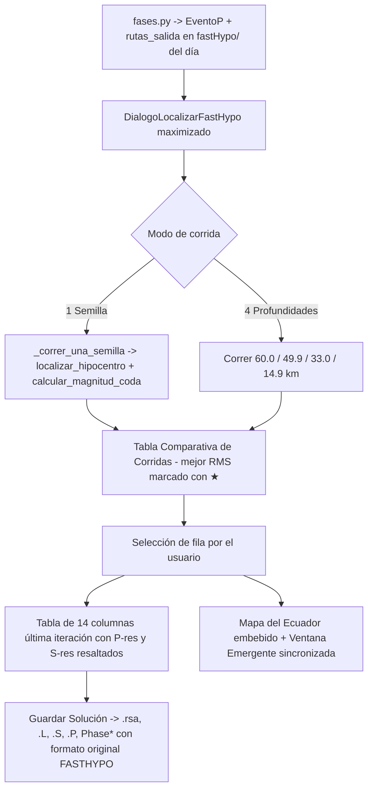

# `procesamiento/src/librerias/rsa_fasthypo.py` — Contexto Técnico para Agentes IA

> Motor autónomo en Python del localizador hipocentral **FASTHYPO** (R. B. Herrmann, 1979) con cálculo de magnitud de duración `Md` (`Mag2000.txt`), generación de salidas compatibles (`.P`, `.L`, `.S`, `Phase*`, `.rsa`) e interfaz gráfica PyQt5 (`DialogoLocalizarFastHypo`) con corridas multi-profundidad y mapa interactivo del Ecuador.

**Ruta**: `procesamiento/src/librerias/rsa_fasthypo.py`  
**Lenguaje**: Python 3.9 (`numpy`, `PyQt5`, `matplotlib`, `shapefile`)  
**Datos maestros**:
- `procesamiento/datos/fasthypo/FHVELOC.DAT` (modelos corticales: `asw`, `ecu`, `pic`, etc.)
- `procesamiento/datos/fasthypo/FHSTA.DAT` (coordenadas y correcciones de estaciones)
- `procesamiento/datos/fasthypo/Mag2000.txt` (coeficientes `b1, c1, c2` por estación)
- `procesamiento/datos/GIS/ECU provincias.shp` (polígonos provinciales WGS84 del Ecuador)

---

## 1. Arquitectura y Flujo de Ejecución

---

## 2. Contratos de Datos y Salidas

- **Modelo de inversión**: Gauss-Newton amortiguado (Levenberg-Marquardt) sobre modelo estratificado 1D (rayos directos por bisección y ondas refractadas), con limitación de paso (`|dz| <= 5 km`, `|dh| <= 50 km`) y covarianza amortiguada por SVD para errores y elipse horizontal (`x, y, theta`).
- **Magnitud de duración (`Md`)**: $M_d = b_1 + c_1 \log_{10}(\text{Coda}) + c_2 \cdot \Delta_{\text{km}}$, usando `Mag2000.txt` (si $b_1 = c_1 = c_2 = 0$ o sin coda $\rightarrow$ `NMG`).
- **Archivos guardados al aceptar**:
  - `.P`, `Phase*`, `.L`, `.S` y `.rsa` (conservan íntegro el formato clásico de FASTHYPO, incluido `crustal model` e historial de iteraciones, garantizando compatibilidad 100 % con `lectura_rsa()` de `rsa_procesamiento.py`).

---

## 3. Interfaz `DialogoLocalizarFastHypo`

- **Ventana completa maximizada** (`Qt.WindowMaximized`) con botones de minimizar, maximizar y cerrar.
- **`QSplitter` horizontal (`52% / 48%`)**:
  - **Panel izquierdo**: parámetros, semillas rápidas RSA (`60 / 49.9 / 33 / 14.9 km`), tabla comparativa de corridas, resumen numérico y tabla de **Detalle Completo de la Última Iteración por Estación** (14 columnas: `Est., Dist, Azm, Ain, P obs, Tp cal, P-res, Wt P, S obs, Ts cal, S-res, Wt S, Coda, Md`).
  - **Resaltado semafórico de `P-res` (col 6) y `S-res` (col 10)**: negrita + fondo verde (`|res| <= 0.30 s`), ámbar (`<= 0.80 s`), rojo (`> 0.80 s`) o gris (`---`).
  - **Panel derecho**: **Mapa de Localización — Ecuador** con `NavigationToolbar2QT`, botón **`🗺️ Ventana Emergente`** (`abrir_mapa_emergente`, `980 × 820`, sincronizada en vivo al cambiar de corrida), estaciones participantes, rayos, corridas alternativas, epicentro seleccionado y elipse de error.
- **Barra inferior fija**: botón **💾 Guardar Solución Seleccionada** siempre visible y confirmación con la ruta exacta de guardado.

---

## 4. Checklist de Verificación y Regresión

- [x] Validado numéricamente contra Golden Master (`Phase191.701` / `111917.01P/L/S` / `11191701.rsa`).
- [x] Corrida multi-profundidad (`60 / 49.9 / 33 / 14.9 km`) resalta el menor RMS y permite seleccionar cualquier solución.
- [x] `P-res` y `S-res` resaltados con código semafórico en la tabla de 14 columnas.
- [x] Mapa del Ecuador vectorial (`ECU provincias.shp`, 188 polígonos) visible en panel amplio y en ventana emergente sincronizada.
- [x] Archivos `.rsa`, `.L`, `.S`, `.P`, `Phase*` grabados con formato original FASTHYPO en `fastHypo/` del día.
