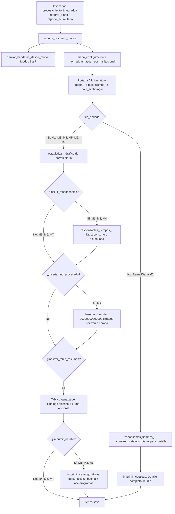

# `src/librerias/rsa_pdf_catalogo.py` — Contexto Técnico para Agentes IA

> Orquestador central de generación de boletines y reportes sísmicos en PDF mediante ReportLab en 7 modalidades operativas e institucionales (M1–M7), incluyendo portadas cartográficas, tablas de catálogo, estadísticas de período, tiempos de responsables y desglose paginado de señales y acelerogramas.

**Ruta**: `src/librerias/rsa_pdf_catalogo.py`  
**LOC**: 937 | **Lenguaje**: Python 3 (ReportLab, CSV, XML)  
**Dependencias**: `reportlab`, `csv`, `librerias.rsa_io`, `librerias.rsa_dominio`, `librerias.rsa_pdf_reportes`, `librerias.rsa_pdf_graficos`, `librerias.metodos_gestion`  
**Proceso**: Invocado por `src/subprogramas/procesamiento_integrado.py` (`Salir_()` y diálogo `reporte_`), `src/subprogramas/reporte_diario.py` y `src/subprogramas/reporte_acumulado.py`.

---

## 1. Arquitectura y Flujo de Generación PDF

---

## 2. Modalidades de Reporte (M0–M7), Perfiles de Mapa (`mapa_`) y Matriz de Banderas

El archivo centraliza en tres diccionarios declarativos y tres funciones puras qué se imprime, qué contiene y para quién es cada reporte:

### 2.1. Catálogo de Modos (`PERFILES_MODO_REPORTE`: M0–M7)

| Modo | Constante | Para quién | `es_periodo` | `incluir_responsables` | `imprimir_detalle` | `insertar_no_procesado` | `mostrar_tabla_resumen` | `solo_catalogo_oficial` | `extras_tecnicos` | `tipo_institucional` | `formato_portada` |
|---|---|---|---|---|---|---|---|---|---|---|---|
| **0** | `MODO_MAPA_ESPECIAL` | Uso cartográfico interno (`Region`, `Fuentes`, `Reportes`) | `True` | `False` | `False` | `False` | `False` | `True` | `False` | `"NO-INST"` | `0` |
| **1** | `MODO_PERIODO_FRANJAS` | Control interno de turnos RSA (por corte `00–12`, `12–18`, `18–24`) | `True` | `True` (`minutos_turno`) | `True` | `True` (por turno) | `True` | `False` | `True` | `"NO-INST"` | `0` |
| **2** | `MODO_DIARIO_REVISION` | Revisión operativa interna diaria | `False` | `True` (`minutos_turno`) | `True` | `False` (usa `_construir_...`) | `False` | `False` | `True` | `"NO-INST"` | `0` |
| **3** | `MODO_OFICIAL_DETALLADO` | Boletín Oficial RSA — Ecuador (Detallado) | `True` | `True` (`horas_acumuladas`) | `True` | `False` | `True` | `True` | `True` | `"NO-INST"` | `0` |
| **4** | `MODO_OFICIAL_RESUMEN` | Boletín Oficial RSA — Ecuador (Ejecutivo) | `True` | `True` (`horas_acumuladas`) | `False` | `False` | `True` | `True` | `False` | `"NO-INST"` | `0` |
| **5** | `MODO_FACULTAD_RESUMEN` | Decanato / Facultad de Ingeniería (Universidad de Cuenca) | `True` | `False` | `False` | `False` | `False` | `True` | `False` | `"FACULTAD"` | `2` |
| **6** | `MODO_INSTITUCIONAL_DETALLADO` | Entidades externas, GADs y empresas hidroeléctricas (Detallado) | `True` | `False` | `True` | `False` | `True` | `True` | `False` | `"GADS"` | `0` |
| **7** | `MODO_INSTITUCIONAL_RESUMEN` | Entidades externas, GADs y empresas hidroeléctricas (Resumen) | `True` | `False` | `False` | `False` | `True` | `True` | `False` | `"GADS"` | `0` |

### 2.2. Sub-banderas Granulares de `extras_tecnicos`
Cuando `extras_tecnicos` es `True` (M1, M2, M3), `derivar_banderas_desde_modo` habilita automáticamente:
* `mostrar_cobertura_red`: Polígonos de cobertura de red (50 km / 150 km) en la portada individual del sismo.
* `mostrar_intentos_proc`: Historial de intentos de procesamiento en la portada del sismo.
* `graficar_todas_estaciones_mseed`: Grafica todas las estaciones con archivo `.mseed` en el evento aunque no estén en la máscara del mapa.
* `mostrar_zoom_seniales`: Recuadros laterales de zoom de fase P (sin filtrar y filtrado) en las hojas de señales.
* `mostrar_lineas_fases`: Líneas verticales rojas de fases P, S y Coda sobre los sismogramas.
* `mostrar_cabecera_interna_rms`: Etiqueta de RMS y número de fases en la cabecera de la hoja de señales.

### 2.3. Perfiles Cartográficos por Índice de Mapa (`PERFILES_MAPA_ZONA` y `obtener_perfil_mapa`)
* `0 (Region)`: `escala_circulos='mitad'`, `estilo_color_sismos='por_profundidad'`, `tipo_resumen_estadistico='matriz_global'`, `mostrar_grafico_barras=True`.
* `1 (Ecuador)`: `escala_circulos='normal'`, `estilo_color_sismos='por_profundidad'`, `tipo_resumen_estadistico='matriz_global'`, `mostrar_grafico_barras=True`.
* `2 (Facultad)`: `escala_circulos='normal'`, `estilo_color_sismos='azul_unico'`, `caja_simbologia_compacta=True`, `tipo_resumen_estadistico='matriz_global'`, `mostrar_grafico_barras=False`.
* `3 (Fuentes)` / `Círculos concéntricos (bandera_relleno == 2)`: `escala_circulos='normal'`, `estilo_color_sismos='halos_difuminados'`, `tipo_institucional='FACULTAD'`, `formato_portada=2`, `caja_simbologia_compacta=True`, `tipo_resumen_estadistico='matriz_global'`, `mostrar_grafico_barras=False`, `mostrar_tabla_resumen=False`, `incluir_responsables=False`, `imprimir_detalle=False` (imprime exclusivamente la primera hoja con el mismo formato compacto del informe para la Facultad).
* `4 (Reportes)`: `escala_circulos='normal'`, `estilo_color_sismos='por_profundidad'`, `tipo_resumen_estadistico='vector_filtrado'`, `mostrar_grafico_barras=False`.
* `>= 5 (Chanlud, Labrado, Huascachaca, Soldados, Ocana, Austro, Elecaustro1, etc.)`: `escala_circulos='normal'`, `estilo_color_sismos='por_profundidad'`, `tipo_resumen_estadistico='vector_filtrado'`, `mostrar_grafico_barras=True`.
* Cuando `es_periodo=False` (reporte diario M2), `obtener_perfil_mapa` activa además `etiquetar_magnitud_hora_mapa=True` y `tipo_resumen_estadistico='matriz_global'` para rotular magnitud y hora UTC junto a cada epicentro en la portada.

---

## 3. Contratos de Datos e Índices del Catálogo

### 3.1. Índices de Columnas de `catalogo` (20 columnas)
* `IDX_INDICE (0)`: Identificador temporal `AAAAMMDDhhmmss` (o `'00000000000000'` para dummies no procesados).
* `IDX_ANIO (1)`, `IDX_MES (2)`, `IDX_DIA (3)`, `IDX_HORA (4)`, `IDX_MINUTO (5)`, `IDX_SEGUNDO (6)`.
* `IDX_LATITUD (7)`, `IDX_LONGITUD (8)`, `IDX_PROFUNDIDAD (9)`, `IDX_RMS (10)`.
* `IDX_E_X (11)`, `IDX_E_Y (12)`, `IDX_E_0 (13)`, `IDX_E_Z (14)`: Errores hipocentrales.
* `IDX_MAGNITUD (15)`, `IDX_UNIDAD_MAG (16)`: Valor de magnitud y tipo (`Md`, `Ml`, `Mw`).
* `IDX_FUENTE (17)`: Red de origen (`RSA`, `IGEPN`, `USGS`, o tipo de evento no procesado).
* `IDX_EVENTO (18)`: Nombre del archivo `.sis` (`AAMMDD_hhmmss.sis`).
* `IDX_LUGAR (19)`: Ubicación geográfica epicentral (`Ciudad, Cantón, Provincia`).

### 3.2. Paginación de Señales en `imprimir_catalogo`
* Cada evento agrupa las estaciones activas (obtenidas de `marcar_impresiones` o de todas las trazas disponibles cuando `mapa_ == 1`) en bloques de **5 estaciones por página** (`paginamiento_estaciones`), invocando `hoja_seniales_(...)` de `rsa_pdf_reportes.py`.
* En la primera página de cada evento (`bandera_primera_hoja = 1`), `hoja_seniales_` imprime primero la hoja resumen del evento (`impresion_reporte_sismo`) si tiene localización o intentos de procesamiento.
* Posteriormente, para cada estación acelerográfica (`tipo_canal[i] == 'ACELEROGRAFICO'`), invoca `impresion_reporte_acelerograma`.

---

## 4. Componentes y Funciones Clave

| Función | Firma | Descripción |
|---|---|---|
| `reporte_resumen_modos` | `(archivo_pdf, subtitulo_reporte, fecha_ini, fecha_fin, catalogo, resumen, mapa_, tipo_mapa, modo_reporte, estaciones, directorio, arbol, resumen_responsables, eventos, bandera_firma, bandera_relleno, horario="")` | Función principal que construye el PDF completo según el modo (1–7), desde la portada hasta el detalle de formas de onda y acelerogramas. |
| `construir_catalogo_temporal_turno` | `(catalogo: list, eventos: list = None, horario: str = "", insertar_no_procesado: bool = False) -> list` | Construye desde cero un catálogo temporal exclusivo para la franja horaria indicada en `horario` (`00:00 - 12:00`, `12:00 - 18:00`, `18:00 - 24:00`), filtrando tanto los sismos procesados de `catalogo` como los eventos no-`Ruido` de `eventos` mediante extracción de hora `[-10:-8]` (compatible con `AAMMDD_hhmmss.sis` y `AAAAMMDD_hhmmss.sis`), sin alterar el catálogo acumulado del día. |
| `imprimir_catalogo` | `(catalogo, arbol, lienzo, directorio, estaciones_informe, tipo_canal, mapa_, raiz, detalle, banderas=None)` | Recorre el catálogo agrupando entradas de distintas redes para un mismo `.sis`, pagina estaciones de 5 en 5 e imprime sismogramas y acelerogramas propagando `banderas`. |
| `marcar_impresiones` | `(lista_eventos, estaciones_informe, tipo_canal, mapa_)` | Determina el vector binario (0/1) de estaciones a graficar según la máscara del mapa, tipo de sensor y bandera de habilitación en el token `EEEECBFFIISS` (índice 5). |
| `responsables_tiempos_` | `(lienzo, resumen_responsables, modo_reporte, banderas=None)` | Dibuja el cuadro de tiempos invertidos por operador según `unidad_responsables`: desglosado en minutos por corte (`minutos_turno`, M1/M2) o acumulado en horas (`horas_acumuladas`, M3/M4). |
| `_filtrar_catalogo_oficial_sin_dummies` | `(catalogo: list) -> list` | Filtra filas dummy con `id == '00000000000000'` para boletines oficiales (M3, M6). |
| `_construir_catalogo_diario_para_detalle` | `(catalogo: list, eventos: list) -> list` | Cruza los eventos del día con el catálogo para M2, priorizando la fuente `RSA` e insertando dummies locales para `FF`, `FC` e `INDEFINIDO` sin procesar. |
| `normalizar_layout_por_institucional` | `(tipo_institucional: str) -> dict` | Devuelve coordenadas y dimensiones físicas de mapa, marca de agua y caja de simbología para portada general (`NO-INST`/`GADS`) vs. Facultad (`FACULTAD`). |
| `obtener_perfil_mapa` | `(mapa_: int, es_periodo: bool = True) -> dict` | Devuelve el perfil cartográfico y estadístico asociado al índice de mapa (`0..26` de `datos/mapas/mapas.csv`). |
| `resolver_modo_por_zona` | `(nombre_zona: str, con_detalle: bool = False) -> int` | Resuelve de forma centralizada el código `MODO_*` (M0, M3–M7) a partir del nombre de la zona seleccionada y si requiere detalle. |
| `derivar_banderas_desde_modo` | `(modo_reporte: int, mapa_: int = None, bandera_firma: bool = False, bandera_relleno: bool = True) -> dict` | Consolida en un único diccionario trazable el perfil del modo (`M0`–`M7`), las 6 sub-banderas técnicas, el perfil del mapa (`mapa_`) y las opciones de firma y relleno. |

---

## 5. Riesgos Específicos y Checklist de Estabilidad

1. **Bloqueo de Archivo PDF en Windows (`PermissionError`)**:
   * `lienzo.save()` fallará con `PermissionError` si el archivo destino está abierto en Adobe Acrobat u otro visor PDF externo. Los llamadores deben validar y liberar el archivo antes de invocar `reporte_resumen_modos`.
2. **Validación de `trCanal[i]` No Vacío**:
   * Antes de invocar `impresion_reporte_acelerograma`, siempre se debe verificar `trCanal[i] and len(trCanal[i]) > 0` para evitar `IndexError` en trazas MiniSEED vacías.
3. **Filtrado por Franja Horaria en M1 (`horario`)**:
   * En `MODO_PERIODO_FRANJAS`, la inserción de eventos no procesados (`insertar_no_procesado`) filtra estrictamente por la hora del evento (`00:00 - 12:00`, `12:00 - 18:00`, `18:00 - 24:00`) cuando se pasa el parámetro `horario`.
