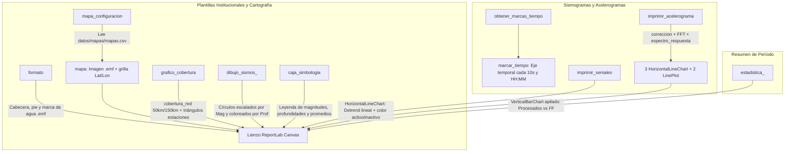

# `src/librerias/rsa_pdf_graficos.py` — Contexto Técnico para Agentes IA

> Motor de primitivas gráficas sobre ReportLab para la generación de reportes sísmicos y acelerográficos: renderizado de plantillas institucionales (`.emf`), mapas geográficos con grillas de coordenadas, polígonos de cobertura de red, epicentros por rango de profundidad/magnitud, trazas sismológicas multicanal (`HorizontalLineChart`), espectros de Fourier/respuesta (`LinePlot`) e histogramas de actividad diaria (`VerticalBarChart`).

**Ruta**: `src/librerias/rsa_pdf_graficos.py`  
**LOC**: 856 | **Lenguaje**: Python 3 (ReportLab, SciPy FFT, NumPy, Matplotlib, ObsPy)  
**Dependencias**: `reportlab`, `scipy.fft`, `numpy`, `matplotlib`, `PyQt5.QtCore.QDate`, `librerias.rsa_dominio`, `librerias.rsa_procesamiento`, `librerias.metodos_gestion`, `librerias.metodos_gis_rsa`  
**Proceso**: Librería de bajo nivel invocada por `rsa_pdf_catalogo.py` y `rsa_pdf_reportes.py`.

---

## 1. Arquitectura de Primitivas Gráficas

---

## 2. Componentes y Funciones Clave

| Función | Firma | Descripción |
|---|---|---|
| `formato` | `(marca_agua, tamanio_hoja, titulo, subtitulo, formato_, lienzo)` | Configura el tamaño de página (`A4` vertical para `formato_ == 0` o `2`, `landscape(A4)` para `formato_ == 1`) y estampa `cabecera.emf`, `pie.emf`, `logoRSA.emf`, título y subtítulo centrados. |
| `mapa_configuracion` | `(mapa_numero, detalle)` | Consulta `datos/mapas/mapas.csv` y retorna `(nombre_mapa_emf, coordenadas, salto, nombre_region, estaciones_informe)`. |
| `mapa` | `(lienzo, imagen, tamanio, coordenadas, salto, bandera)` | Inserta el archivo `.emf` del mapa en `tamanio = (xpos, ypos, ancho, alto)` y dibuja el marco con marcas y etiquetas de Latitud/Longitud si `bandera == 1`. |
| `dibujo_sismos_` | `(lienzo, vector, coordenadas, tamanio, titulo_mapa, bandera_dia, bandera_relleno, banderas=None)` | Proyecta y dibuja los epicentros de la RSA (`vector[i][4] == 0`) dentro del recuadro del mapa según `estilo_color_sismos` (`por_profundidad`, `azul_unico` o `halos_difuminados`), `escala_circulos` (`mitad` o `normal`) y `etiquetar_magnitud_hora_mapa`. |
| `dibujar_lugar_geometrico_pdf` | `(lienzo, poligono_enjambre, coordenadas, tamanio)` | Proyecta y dibuja sobre el mapa de portada `.emf` en ReportLab el contorno del lugar geométrico del enjambre (Círculo, Rectángulo o Polígono) recortado con `shapely.geometry.box` a los límites del mapa y trazado con línea segmentada azul (`#1d4ed8`). |
| `caja_simbologia` | `(lienzo, resumen, vector, ubicacion_caja, mapa_, bandera_dia, bandera_relleno, banderas=None)` | Dibuja los recuadros de simbología según `caja_simbologia_compacta` y `escala_circulos`, y calcula el promedio diario de sismos localizados y no localizados según `tipo_resumen_estadistico` (`matriz_global` o `vector_filtrado`). |
| `grafico_cobertura` | `(lienzo, evento, coordenadas, tamanio, directorio_trabajo)` | Superpone en el mapa los polígonos convexos de cobertura de red a $150\text{ km}$ (verde) y $50\text{ km}$ (rojo) junto con las estaciones habilitadas como triángulos azules. |
| `obtener_marcas_tiempo` | `(tr)` | Extrae de un `Stream` ObsPy el tiempo inicial, segundo inicial, duración en segundos y la lista `catNames` con etiquetas cada $10\text{ s}$ (`SS`) y cada cambio de minuto (`HH:MM`). |
| `marcar_tiempo` | `(lienzo, x_, y_, tiempo_inicio, ancho, duracion, catNames)` | Dibuja sobre el `lienzo` las marcas verticales y etiquetas de tiempo generadas por `obtener_marcas_tiempo`. |
| `imprimir_seniales` | `(tamanio, canales, trcanal, evento, bandera_seniales, bandera_zoom)` | Genera un `Drawing` con los sismogramas de las estaciones activas en `canales`: aplica `detrend('linear')`, dibuja trazas en azul (si la estación aportó al procesamiento, `evento[i+3][5] == '1'`) o gris (si fue deshabilitada, `'0'`), y añade línea roja central en modo zoom (`bandera_zoom == 1`). |
| `imprimir_acelerograma` | `(tamanio, trcanal, componente, factor, bandera)` | Calcula aceleración, velocidad y desplazamiento mediante `correccion(trcanal[i], factor)`, genera los 3 gráficos temporales (`HorizontalLineChart`), el espectro de Fourier (`scipy.fft.fft`) y, cuando `bandera == 0` (reporte individual), el espectro de respuesta elástico al $5\%$ (`espectro_respuesta`). |
| `estadistica_` | `(lienzo, resumen, fecha_ini, mapa_, bandera_dia, banderas=None)` | Construye un gráfico de barras apiladas (`VerticalBarChart`) cuando `mostrar_grafico_barras` es `True`, adaptándose a `tipo_resumen_estadistico` (`matriz_global` con procesados + FF vs `vector_filtrado` solo procesados). |
| `escalado` | `(numero)` | Calcula el paso óptimo de división del eje vertical (`valueStep`) para gráficos de aceleración, velocidad y desplazamiento según el orden de magnitud del máximo absoluto. |
| `encontrar_cadena` | `(lista, cadena)` | Busca el índice de `cadena` en `lista`, retornando `-1` si no existe. |

---

## 3. Contratos de Datos y Coordenadas Físicas

* **Coordenadas en `mapa_configuracion` vs `mapa`**:
  * `mapa_configuracion` retorna `coordenadas = (lon_min, lat_min, lon_max, lat_max)` leídas de `datos/mapas/mapas.csv`.
  * En `dibujo_sismos_` y `grafico_cobertura`, `coordenadas[0]` es `longitud_min` (eje X) y `coordenadas[1]` es `latitud_min` (eje Y).
* **Marcador de Espacio en Blanco en `imprimir_seniales`**:
  * Cuando `trcanal[i][0] == ' '` (usado en los recuadros de zoom cuando una estación no tiene marca P o no tiene filtro configurado), `imprimir_seniales` incrementa el `contador` vertical y salta el dibujo del `HorizontalLineChart`, manteniendo la correspondencia exacta de fila con la traza principal de la izquierda.

---

## 4. Riesgos Específicos y Checklist de Estabilidad

1. **Dependencia de Archivos Vectoriales `.emf` en `datos/`**:
   * `formato` y `mapa` requieren la existencia de `datos/cabecera.emf`, `datos/cabecera_1.emf`, `datos/pie.emf`, `datos/logoRSA.emf` y `datos/mapas/*.emf`. En Windows, ReportLab renderiza `.emf` nativamente a través de GDI/PIL.
2. **Protección de Índices en `trcanal`**:
   * En `imprimir_seniales`, siempre debe evaluarse `trcanal[i] and len(trcanal[i]) > 0` antes de indexar `trcanal[i][0]` porque un `Stream` ObsPy vacío evalúa como `False` en booleano pero indexar `[0]` sin verificar lanza `IndexError`.
3. **Ventana Interactiva de Matplotlib en `imprimir_acelerograma`**:
   * Cuando `bandera == 0` (reporte individual de acelerograma), las líneas 577–581 abren una figura interactiva con `plt.show()` mostrando el espectro de Fourier antes de terminar de construir el PDF.
