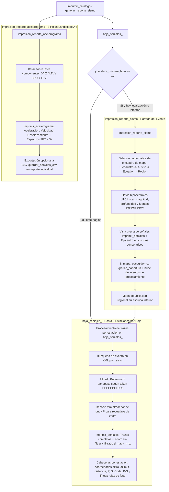

# `src/librerias/rsa_pdf_reportes.py` — Contexto Técnico para Agentes IA

> Generador de páginas detalladas de eventos sísmicos en ReportLab: ficha cartográfica e hipocentral por sismo (`impresion_reporte_sismo`), hojas de formas de onda paginadas con zoom y marcas de fases P/S/Coda (`hoja_seniales_`), y reportes acelerográficos por componente en formato horizontal (`impresion_reporte_acelerograma`).

**Ruta**: `src/librerias/rsa_pdf_reportes.py`  
**LOC**: 655 | **Lenguaje**: Python 3 (ReportLab, ObsPy, PyQt5 QDate/QTime)  
**Dependencias**: `reportlab`, `PyQt5.QtCore`, `librerias.rsa_io`, `librerias.rsa_pdf_graficos`, `librerias.metodos_rsa`, `librerias.metodos_gestion`  
**Proceso**: Invocado desde `rsa_pdf_catalogo.py` (durante la generación de reportes de período/diarios) y desde `metodos_reportes_individuales.py` (para reportes individuales de un evento).

---

## 1. Arquitectura y Flujo de Renderizado

---

## 2. Contratos de Datos y Lógica Sismológica

### 2.1. Selección Jerárquica de Encuadre Cartográfico (`impresion_reporte_sismo`)
* Recorre `for mapa_ in range(3, -1, -1)` (`3: Elecaustro`, `2: Austro`, `1: Ecuador`, `0: Región`) y selecciona el primer mapa cuyas coordenadas límite contengan el epicentro `(longitud, latitud)`.
* Si `mapa_ > 1` (Austro o Elecaustro), dibuja además un recuadro inferior con el mapa del Ecuador (`mapa_configuracion(1, 0)`) indicando la ubicación regional, ubicándolo a la derecha (`xpos=380`) si `longitud < -79` o a la izquierda (`xpos+5`) en caso contrario para no tapar el epicentro.
* Del mismo modo, el recuadro de señales en miniatura (`tamanio=(105, 180)`) se posiciona dinámicamente en `xpos+340` si `longitud < -79` o en `xpos+5` si `longitud >= -79`.

### 2.2. Resolución de Eventos en el Árbol XML (`hoja_seniales_`)
* Para evitar colisiones cuando ocurren **múltiples sismos dentro del mismo minuto** (que comparten el mismo `<id_evento>` de 12 dígitos `AAAAMMDDhhmm`), `hoja_seniales_` busca primero el nodo `<Evento>` en `raiz` comparando el nombre del archivo `.sis` en el tag `<ruta>` (`Path(ruta_ev).name == nombre_sis`). Solo si no lo encuentra recurre al fallback por `<id_evento>`.

### 2.3. Filtrado y Zoom Alrededor de la Fase P (`hoja_seniales_`)
* Para cada estación `i` de las 101 posibles, lee el token de configuración `dato[i+3]` (`EEEECBFFIISS`):
  - `grado_ = int(estacion_completa[6:8])`
  - `freqmin_ = int(estacion_completa[8:10])`
  - `freqmax_ = int(estacion_completa[10:12])`
* Si `grado_ != 0`, aplica un filtro pasabanda (`filter("bandpass", freqmin=freqmin_, freqmax=freqmax_, corners=grado_)`) sobre `trCanal[i][0]` y `trCanal_copia_filtrada[i][0]`.
* Recorta (`trim`) una ventana de $\pm \text{duracion}/40$ segundos alrededor del arribo de la onda P (`fase_p`) en `trCanal_copia` (cruda) y `trCanal_copia_filtrada` (filtrada) para dibujar los dos recuadros laterales de zoom cuando `mapa_ == 1` (control interno).

---

## 3. Componentes y Funciones Clave

| Función | Firma | Descripción |
|---|---|---|
| `impresion_reporte_sismo` | `(lienzo_archivo, evento_generar, canales, trCanal, bandera_periodo, directorio_trabajo, mapa_escogido, banderas=None)` | Genera la hoja de portada individual de un sismo con mapa, localización UTC/Local, señales miniatura, cobertura de red (`mostrar_cobertura_red`) e historial de intentos (`mostrar_intentos_proc`). Si `bandera_periodo == 0`, crea y guarda un PDF independiente; si es `1`, dibuja sobre el `lienzo` activo y lo retorna. |
| `hoja_seniales_` | `(directorio_trabajo, lienzo, evento_catalogo, evento_generar, evento, pagina, trCanal, raiz, mapa_, detalle, bandera_primera_hoja, banderas=None)` | Renderiza una página con hasta 5 estaciones (`pagina`), incluyendo metadatos de estación, parámetros de fase del XML, cabecera interna de RMS (`mostrar_cabecera_interna_rms`), marcas verticales de fases P/S/Coda (`mostrar_lineas_fases`) y recuadros laterales de zoom (`mostrar_zoom_seniales`). |
| `impresion_reporte_acelerograma` | `(archivo, trcanal, estacion, datos_sismo, bandera)` | Genera 3 páginas en formato `landscape(A4)` (una por componente del acelerógrafo) con trazas corregidas de aceleración, velocidad, desplazamiento y espectros. Retorna `(lienzo, maximos)` si `bandera == 1`, o guarda el PDF y exporta el CSV de señales si `bandera == 0`. |
| `cabecera_` | `(catalogo_escogido)` | Construye un `Drawing` de cabecera A4 con datos básicos de localización del evento. |

---

## 4. Riesgos Específicos y Checklist de Estabilidad

1. **Trazas Vacías tras `trim()` o Canales sin Datos**:
   * Cuando un `Stream` queda vacío tras `trim()` o no tiene datos (`len(trCanal[i]) == 0`), debe reemplazarse por el marcador `[' ']` antes de enviarse a `imprimir_seniales` para conservar la alineación vertical de los 5 bloques de la página sin provocar `IndexError`.
2. **Mapeo Transitorio `CHAN` -> `CHAI`**:
   * En `hoja_seniales_` existe la regla explícita `if estacion == 'CHAN': estacion = 'CHAI'` y `datos_estaciones['CODIGO'][2] = 'CHAI'` para compatibilidad con los códigos emitidos por el localizador en la estación Chanlud.
3. **Mutación In-Place de `trCanal`**:
   * `hoja_seniales_` filtra `trCanal[i][0]` in-place cuando `grado_ != 0`. Si un evento tiene múltiples páginas de estaciones, las páginas subsecuentes reciben `trCanal` ya filtrado en las estaciones procesadas previamente.
4. **Eventos `FF` / `FC` con Solución Exclusiva de Otras Redes (`evento_generar[0] == []`)**:
   * En `impresion_reporte_sismo`, cuando `evento_generar[0] == []`, se selecciona siempre `reporte = 1` (`evento_generar[1]`) independientemente de si la fuente vinculada es `IGEPN`, `USGS` u `Otras redes` (incluso cuando solo hay una red externa y `len(evento_generar) == 2`), y `forzar_sin_convergencia` solo se activa si no existe ni solución `RSA` ni solución de otra red externa.
