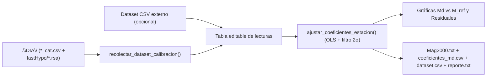

# `procesamiento/src/subprogramas/calibrar_magnitud_md.py` — Contexto Técnico

> Subprograma `QWidget` integrado en el menú **`Configuración`** de `programa_integrado.py` para calibrar los coeficientes empíricos `(b1, c1, c2)` de Magnitud de Duración ($M_d = b_1 + c_1 \log_{10}(\text{Coda}) + c_2 \Delta$) por estación y generar `Mag2000.txt` con trazabilidad completa.

**Ruta**: `procesamiento/src/subprogramas/calibrar_magnitud_md.py`  
**Manual de Usuario**: `procesamiento/docs/manual_calibracion_magnitud_md.md`  
**Entorno**: `C:\entornos\sismologia_py39_v2` (Python 3.9, PyQt5, NumPy, Matplotlib)

## 1. Flujo de Datos

## 2. Contratos de Entrada/Salida
* **Entradas**:
  * Catálogos diarios `*_cat.csv` (columnas `IDX_ANIO..IDX_SEGUNDO`, `IDX_RMS`, `IDX_MAGNITUD`, `IDX_UNIDAD_MAG`, `IDX_FUENTE`, `IDX_EVENTO`).
  * Archivos `.rsa` de FASTHYPO (fecha, `rms=`, tabla `sta dist ...`, bloque `CALCULO DE LA MAGNITUD`).
  * Opcional: `Mag2000.txt` previo como plantilla.
* **Salidas**:
  * `Mag2000.txt` (formato fijo `<STA4> <b1:8.6f> <c1:8.6f> <c2:8.6f>`, con respaldo automático `.txt`).
  * `coeficientes_md_<ts>.csv`, `dataset_calibracion_md_<ts>.csv`, `reporte_calibracion_md_<ts>.txt`.

## 3. Checklist de Regresión
- [x] Abre desde `Configuración → Calibración de Magnitud (Md — Mag2000.txt)` en Estado A.
- [x] Escaneo en `QThread` sin congelar la interfaz.
- [x] Exportación de `Mag2000.txt` compatible con `Iaspei.frm` y `hypo/src/fasthypo.py`.
- [x] Botón `📖 Manual de Usuario` y ayuda contextual `F1` operativos.
