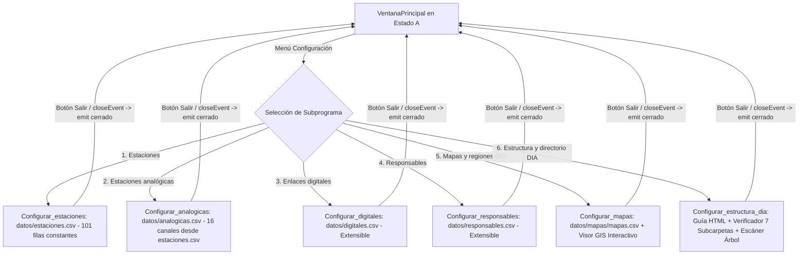

# `src/subprogramas/configuracion_sistema.py` — Contexto Técnico para Agentes IA

> Suite de 6 subprogramas basados en `QWidget` para la administración de los archivos maestros de configuración de la Red Sísmica de Alerta (`datos/estaciones.csv`, `datos/analogicas.csv`, `datos/digitales.csv`, `datos/responsables.csv`, `datos/mapas/mapas.csv`) y la documentación/inspección interactiva de la estructura del directorio de trabajo `..\DIA\`.

**Ruta**: `src/subprogramas/configuracion_sistema.py`  
**Lenguaje**: Python 3 (PyQt5, Matplotlib, GeoPandas)  
**Dependencias**: `PyQt5.QtWidgets`, `matplotlib`, `librerias.rsa_io`, `librerias.metodos_gestion`, `librerias.metodos_gis_rsa`, `librerias.rsa_utilidades`  
**Proceso**: Invocado desde `src/programa_integrado.py` (Menú `Configuración` en Estado A) mediante `cargar_widget_menu(..., requiere_inicializacion=False)`.

---

## 1. Arquitectura y Flujo de Interacción

---

## 2. Contratos de Datos y E/S

1. **`datos/estaciones.csv` (`Configurar_estaciones`)**:
   - **Cantidad constante**: 101 registros (`0` a `100` en columna `ESTACION(21)`) + 1 fila de cabecera (25 columnas separadas por `;`).
   - Prohibido añadir o eliminar filas para preservar la indexación posicional `+3` de la matriz maestra de eventos.
2. **`datos/analogicas.csv` (`Configurar_analogicas`)**:
   - **Cantidad constante**: 16 canales analógicos + cabecera `ESTACION;NOMBRE;CODIGO`.
   - Cada canal se selecciona mediante un `QComboBox` alimentado desde `estaciones.csv`, completando automáticamente `ESTACION`, `NOMBRE` y `CODIGO`.
3. **`datos/digitales.csv` (`Configurar_digitales`)**:
   - **Cantidad extensible**: Cabecera `Est. Digital;Numero;Habilitado`. Permite editar, agregar o eliminar enlaces digitales vinculados a `estaciones.csv`.
4. **`datos/responsables.csv` (`Configurar_responsables`)**:
   - **Cantidad extensible**: Sin cabecera, 3 columnas `<Responsable>;<Drive Virtual 1>;<Drive Virtual 2>`. Protege la fila maestra `RSA`.
5. **`datos/mapas/mapas.csv` (`Configurar_mapas`)**:
   - **Cantidad extensible**: Cabecera `nombre;lat_min;lat_max;long_min;long_max;salto;estaciones`. Protege las 5 primeras filas estructurales (`Region`, `Ecuador`, `Facultad`, `Fuentes`, `Reportes`) contra eliminación o renombrado.
6. **Directorio `..\DIA\` (`Configurar_estructura_dia`)**:
   - Módulo estrictamente instructivo (solo lectura): muestra el `directorio_trabajo` de referencia, simula las rutas de las 7 subcarpetas canónicas para cualquier fecha (`mseed/registros`, `mseed/eventos`, `dia`, `fastHypo`, `procesamiento`, `acelerogramas`, `reportes`) sin crear carpetas ni modificar `config_local_pc.json`, presenta la guía HTML completa y ofrece un explorador/exportador de árbol de inventario en `.txt` y `.json`.
7. **Respaldo del programa (`Respaldar_programa`)**:
   - Habilitado únicamente cuando `pc_administrador: true` en `config_local_pc.json`. Comprime `datos/`, `modulos externos/` y `src/` excluyendo `VW Backup`, Vectorworks (`*.vwx`, `*.vwxw`, `*.vwt`, `*.mcd`) y `__pycache__`/`*.pyc`, y restaura/actualiza por fecha copiando solo archivos nuevos o más recientes con `QProgressBar` en `QThread`.

---

## 3. Componentes y Métodos Clave

| Clase / Método | Tipo | Descripción |
|---|---|---|
| `Configurar_estaciones` | `QWidget` | Formulario y tabla con buscador para editar los 25 campos de las 101 estaciones sísmicas/acelerográficas. |
| `Configurar_analogicas` | `QWidget` | Tabla de 16 canales con selectores `QComboBox` enlazados a `estaciones.csv`. |
| `Configurar_digitales` | `QWidget` | CRUD de enlaces digitales asociados por número de estación y bandera `Habilitado`. |
| `Configurar_responsables` | `QWidget` | CRUD de operadores y unidades virtuales con diagnóstico en vivo de montaje en el PC. |
| `Configurar_mapas` | `QWidget` | Editor de regiones con visor GIS (`RectangleSelector` para dibujar el recuadro y clic derecho para asociar estaciones). |
| `Configurar_estructura_dia` | `QWidget` | Guía instructiva (solo lectura) de la jerarquía `DIA/`, simulador de rutas por fecha y escáner de árbol. |

---

## 4. Decisiones de Diseño

* **Arquitectura `QWidget` Unificada**: Los 6 módulos heredan de `QWidget` y emiten `cerrado = pyqtSignal()`, integrándose en `VentanaPrincipal` mediante la pila LIFO y regresando limpiamente al **Estado A** al salir.
* **Interacción Cartográfica en `Configurar_mapas`**: Reutiliza `_obtener_capas_base_gis()` (`ecuador.shp` y `ECU provincias.shp` en caché) junto con `RectangleSelector` de Matplotlib para dibujar visualmente el encuadre y ver en tiempo real qué estaciones caen dentro de la región.

---

## 5. Riesgos Técnicos y Reglas de Integridad

* **Invariante de 101 Estaciones (`estaciones.csv`) y 16 Canales (`analogicas.csv`)**: Ninguna modificación futura debe habilitar la inserción o borrado de filas en estos dos archivos.
* **Invariante de los 5 Primeros Mapas (`mapas.csv`)**: Las posiciones `0..4` (`Region`, `Ecuador`, `Facultad`, `Fuentes`, `Reportes`) están asociadas por índice en `rsa_pdf_catalogo.py` y deben conservarse siempre al inicio del archivo.

---

## 6. Checklist de Verificación y Regresión

- [x] Los 6 módulos abren desde el menú `Configuración` en Estado A y al salir restauran `Inicio` y `Configuración` vía LIFO.
- [x] `Configurar_estaciones` conserva exactamente 101 filas (`0..100`) y 25 columnas.
- [x] `Configurar_analogicas` conserva exactamente 16 canales alimentados desde `estaciones.csv`.
- [x] `Configurar_digitales` y `Configurar_responsables` permiten agregar nuevos registros y persisten en `;`.
- [x] `Configurar_mapas` grafica el recuadro y las estaciones sobre el mapa GIS del Ecuador.
- [x] `Configurar_estructura_dia` muestra la guía de directorios, diagnostica las 7 subcarpetas y escanea árboles en `TXT`/`JSON`.
