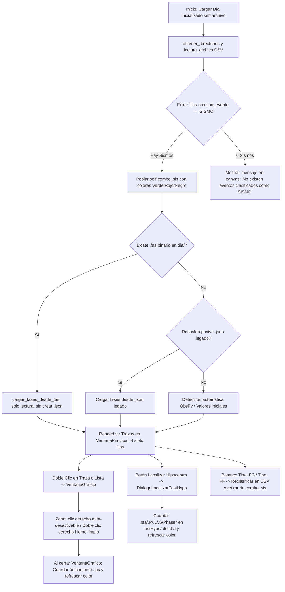

# `procesamiento/src/subprogramas/fases.py` — Contexto Técnico para Agentes IA

> Subprograma de visualización y marcado interactivo de fases sísmicas (P, S, Coda), persistencia directa y exclusiva en formato binario canónico `.fas` (HYPO71), reclasificación rápida a `FC`/`FF`, semáforo de estado de eventos y lanzamiento directo del localizador hipocentral **FASTHYPO** en Python (`rsa_fasthypo.py`).

**Ruta**: `procesamiento/src/subprogramas/fases.py`  
**Lenguaje**: Python 3.9 (PyQt5, ObsPy, Matplotlib)  
**Dependencias**: `PyQt5`, `obspy`, `matplotlib`, `librerias.gestor_fases.GestorFases`, `librerias.metodos_rsa`, `librerias.metodos_gestion`, `librerias.rsa_procesamiento`, `librerias.rsa_fasthypo`  
**Proceso**: Invocado desde `procesamiento/src/programa_integrado.py` (`Procesamiento -> Marcar fases`).

---

## 1. Arquitectura y Flujos de Ejecución



---

## 2. Contratos de Datos y Persistencia

### 2.1. Estructura en Memoria `self.fases_detectadas[archivo]`
```python
{
    "P": [4.87],            # Tiempo de arribo fase P en segundos relativos
    "S": [16.11],           # Tiempo de arribo fase S en segundos relativos
    "Coda": [20.47],        # Tiempo de término de coda en segundos relativos
    "tipo_p": "I",          # 'I' (Impulsivo), 'E' (Emergente) o ' ' (Ninguno)
    "polaridad_p": "+",     # '+', '-', 'C', 'D' o ' ' (Ninguno)
    "peso_p": 0,            # Ponderación HYPO71 de 0 (100%) a 4 (0%/Excluir)
    "polaridad_s": " ",     # '+', '-', 'C', 'D' o ' ' (Ninguno)
    "peso_s": 2             # Ponderación HYPO71 de 0 a 4
}
```

### 2.2. Persistencia Exclusiva en `.fas` (Sin Generación de `.json`)
- `guardar_evento()` escribe **únicamente** el archivo binario canónico `<evento>.fas` (16 ranuras HYPO71) en `dia/`.
- **No se crean archivos `<evento>.json`** en `dia/` para mantener intacta la estructura histórica de `DIA\`.
- Si existiera un `.json` antiguo sin `.fas`, `cargar_evento()` lo lee de forma pasiva como respaldo.

### 2.3. Rutas Canónicas de Salida FASTHYPO
- `abrir_localizador_fasthypo()` invoca `archivos_fast(evento_actual, self.directorio_trabajo, '', modo_minuto_fast='auto')` + `verificar_coincidencias(...)` (con `usuario=''` para evitar redirección a carpetas legadas de `responsables.csv`) y fija explícitamente la carpeta destino a `self.directorios['Directorio_fastHypo']` del día correspondiente (`...\YYYY\YYYY_MM\YYYY_MM_DD\fastHypo\`).

### 2.4. Código de Colores en `combo_sis` (Idéntico a `procesamiento_integrado.py`)
- **Verde (`#009600`, negrita)**: `EXITOSO` (`.sis` + `.fas` + `.rsa`, `Mag > 0` y `RMS <= 1.4`).
- **Rojo (`#C80000`, negrita)**: `INCONVENIENTE` (falta `.sis`, o tiene `.fas` sin `.rsa`, `Mag <= 0` o `RMS > 1.4`).
- **Negro (`#000000`, normal)**: `PENDIENTE` (solo `.sis`, aún sin `.fas`).

---

## 3. Componentes y Métodos Clave

| Método / Clase | Tipo | Descripción |
|---|---|---|
| `VentanaPrincipal` | `QMainWindow` | Ventana principal con controles, reclasificación `FC`/`FF`, semáforo de eventos y acceso a FASTHYPO. |
| `evaluar_estado_evento(nombre_evento)` | Método | Evalúa `.sis`, `.fas`, `.rsa`, `*_proc.csv`, `Mag` y `RMS` retornando `EXITOSO` / `INCONVENIENTE` / `PENDIENTE`. |
| `aplicar_estilo_item_evento` / `actualizar_estilo_combo_actual` | Métodos | Aplican color, negrita y tooltip en `combo_sis` y sincronizan el estilo del elemento activo. |
| `reclasificar_evento_actual(nuevo_tipo)` | Método | Cambia `fila[2]` en la matriz CSV del día a `FC` o `FF`, persiste con `escritura_archivo` y retira el evento del combo `SISMO`. |
| `construir_evento_p_desde_fases()` | Método | Traduce las fases picadas en memoria a `EventoP` para el localizador FASTHYPO. |
| `abrir_localizador_fasthypo()` | Método | Resuelve las rutas en `fastHypo/` del día, abre `DialogoLocalizarFastHypo` y refresca el color al guardar. |
| `VentanaGrafico` | `QMainWindow` | Subventana de picado fino con botones Minimizar/Maximizar/Cerrar, opciones `"Ninguno"` en Tipo P / Pol P / Pol S y limpieza completa de zoom (`_desactivar_zoom_si_activo`, `_restaurar_vista_sin_zoom`). |

---

## 4. Decisiones de Diseño y Riesgos Controlados

1. **Limpieza completa del modo Zoom en `VentanaGrafico`**:
   - Al soltar clic izquierdo tras el recuadro de zoom, `QTimer.singleShot(0, self._desactivar_zoom_si_activo)` desactiva `'zoom rect'` devolviendo el clic izquierdo al arrastre de fases.
   - `_desactivar_zoom_si_activo()` desconecta además `toolbar._zoom_info.cid` (`drag_zoom`), elimina la banda elástica (`remove_rubberband()`) y limpia `_zoom_info = None`, evitando que el doble clic derecho (`home()`) deje el rectángulo de zoom colgado pidiendo el segundo vértice.
2. **Botón `..dia\` oculto sin alterar `marcar_fases.ui`**:
   - `boton_directorio` se oculta por código y en `layoutBotonesInferiores` se insertan `Tipo: FC` y `Tipo: FF`.
3. **Uso de `currentData()` / `findData()` en `VentanaGrafico`**:
   - Garantiza que `"Ninguno"` se persista siempre como `' '` (espacio HYPO71) tanto en memoria como en `.fas`.

---

## 5. Checklist de Verificación y Regresión

- [x] `combo_sis` colorea eventos en Verde (`#009600`), Rojo (`#C80000`) y Negro (`#000000`) y actualiza el color tras guardar `.fas` o `.rsa`.
- [x] `guardar_evento()` genera únicamente `.fas` y no crea archivos `.json`.
- [x] `abrir_localizador_fasthypo()` guarda los 5 archivos FASTHYPO en `fastHypo/` del día correspondiente.
- [x] Doble clic derecho en `VentanaGrafico` restaura `Home` sin dejar el modo zoom activo ni el rectángulo pendiente.
- [x] Combos de `VentanaGrafico` incluyen `"Ninguno"` en `Tipo P`, `Pol P` y `Pol S`.
- [x] Botones `Tipo: FC` y `Tipo: FF` reclasifican el evento en el CSV del día.
