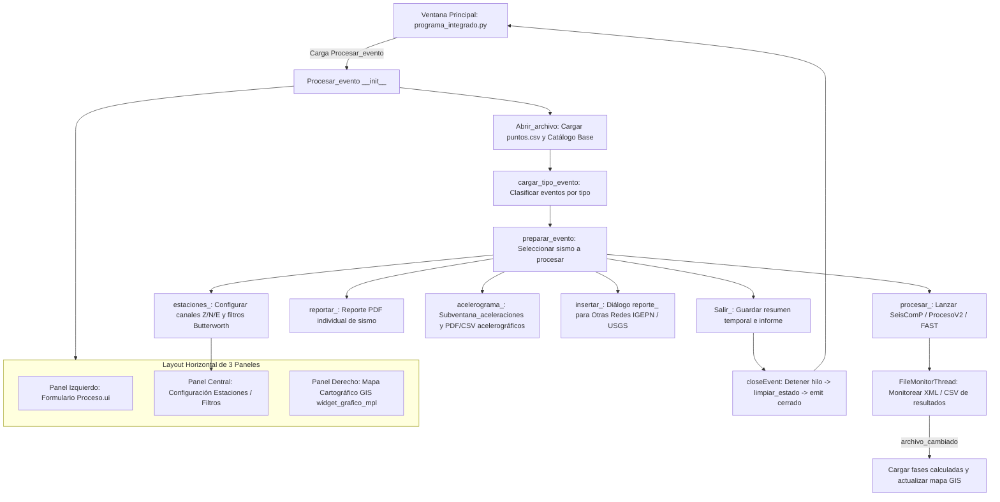

# `src/subprogramas/procesamiento_integrado.py` — Contexto Técnico para Agentes IA

> Núcleo operativo y analítico del procesamiento sísmico de la Red Sísmica de Alerta (RSA). Integra la revisión de eventos, picado de fases, localización hipocentral (SeisComP / ProcesoV2 / FAST), visualizador cartográfico GIS embebido y generación automatizada de catálogos y boletines PDF en 7 modalidades.

**Ruta**: `src/subprogramas/procesamiento_integrado.py`  
**LOC**: 2200 | **Lenguaje**: Python 3 (PyQt5, Matplotlib, ObsPy, NumPy, XML)  
**Dependencias**: `PyQt5`, `obspy`, `matplotlib`, `numpy`, `librerias.rsa_io`, `librerias.rsa_procesamiento`, `librerias.metodos_gis_rsa`, `librerias.metodos_rsa`, `librerias.metodos_gestion`, `librerias.metodos_reportes_individuales`, `librerias.rsa_pdf_catalogo`, `librerias.rsa_utilidades`  
**Proceso**: Invocado desde la ventana principal `src/programa_integrado.py` (`Procesamiento -> Procesamiento integrado`) mediante `cargar_widget_menu()`.

---

## 1. Arquitectura de 3 Paneles y Flujo Operativo

---

## 2. Modalidades de Reporte Sísmico Institucional (Modos 1 a 7)

El módulo define y gestiona 7 modos de generación de catálogos y boletines PDF:

| Modo | Constante / Código | Denominación y Alcance Técnico |
|---|---|---|
| **M1** | `MODO_PERIODO_FRANJAS` (1) | Período por franjas horarias de turno (`00–12`, `12–18`, `18–24`) para control interno. |
| **M2** | `MODO_DIARIO_REVISION` (2) | Reporte diario de revisión con detalle técnico completo y eventos locales/dummies. |
| **M3** | `MODO_OFICIAL_DETALLADO` (3) | Boletín oficial detallado (solo eventos confirmados del catálogo) + página de responsables. |
| **M4** | `MODO_OFICIAL_RESUMEN` (4) | Resumen oficial institucional (solo catálogo condensado, sin desglose de fases). |
| **M5** | `MODO_FACULTAD_RESUMEN` (5) | Resumen ejecutivo institucional para Facultad y redes colaboradoras. |
| **M6** | `MODO_INSTITUCIONAL_DETALLADO` (6) | Catálogo técnico detallado sin campos administrativos de operadores. |
| **M7** | `MODO_INSTITUCIONAL_RESUMEN` (7) | Resumen institucional sintético de alta dirección. |

---

## 3. Clases y Componentes Principales

| Clase / Componente | Tipo / Herencia | Responsabilidad y Operaciones |
|---|---|---|
| `FileMonitorThread` | `QThread` | Hilo de monitoreo asíncrono que detecta modificaciones en archivos de salida de procesamiento sísmico (`.xml`, `.csv`) e informa a la GUI vía `archivo_cambiado`. |
| `Procesar_evento` | `QWidget` | Orquestador central de procesamiento sísmico, manejo de eventos, interacción con FAST/SeisComP, mapa GIS y reportes. |
| `Cambio_Coeficientes_Filtro` | `QWidget` | Subinterfaz para modificar interactivamente frecuencias de corte (`finf`, `fsup`) y orden de filtros Butterworth por canal. |
| `estaciones_` | `QWidget` | Subpanel compacto (`495x550`) integrado en el panel central para habilitar/deshabilitar estaciones, canales (`Z`, `N`, `E`), ganancias visuales y alternar entre vista de Mapa y Señales paginadas (`Btn_pagina` / `cambio_pagina()`). |
| `reporte_` | `QDialog` | Diálogo modal emergente (`520x290`) para asociar e insertar boletines de otras redes (`IGEPN`, `USGS`, `Otras redes`) al evento en curso, mostrando en tiempo real las redes ya registradas en el catálogo para ese evento. |

---

## 4. Métodos Clave de `Procesar_evento`

| Método | Firma | Descripción |
|---|---|---|
| `Abrir_archivo()` | `()` | Carga el archivo base del día, inicializa combos de filtros, listas de eventos y parsea el catálogo existente. |
| `evaluar_estado_evento()` | `(nombre_evento)` | Diagnostica el estado del evento retornando `'EXITOSO'` (verde), `'INCONVENIENTE'` (rojo) o `'PENDIENTE'` (negro) según archivos `.sis`, `.fas`, `.rsa`, magnitud y RMS. |
| `aplicar_estilo_item_evento()` | `(idx, nombre_evento)` | Aplica color, peso tipográfico y tooltip explicativo al ítem correspondiente en `cmbx_eventos`. |
| `evento_esta_procesado()` | `(nombre_evento)` | Verifica si un evento fue procesado exitosamente (delegado en `evaluar_estado_evento() == 'EXITOSO'`). |
| `actualizar_estilo_combo_actual()` | `()` | Aplica formato visual dinámico al QComboBox cerrado (`#009600` para exitoso, `#C80000` para inconveniente o neutro si pendiente). |
| `preparar_evento()` | `(nombre_evento)` | Carga la traza MiniSEED del evento seleccionado, inicializa las fases sismológicas y actualiza el mapa GIS. |
| `procesar_()` | `()` | Ejecuta el procesamiento de fases sísmicas y localización hipocentral mediante ProcesoV2 / SeisComP / FAST. |
| `reportar_()` | `()` | Genera el reporte PDF individual (`<evento>_rep.pdf`) del sismo actual mediante `generar_reporte_sismo(..., self.directorio_trabajo)`. |
| `acelerograma_()` | `()` | Abre `Subventana_aceleraciones` mediante `generar_reporte_acelerograma(...)` para seleccionar estaciones y generar reportes acelerográficos individuales (`<EST>_<evento>_rep.pdf` y `.csv`). |
| `insertar_()` | `(text=False)` | Abre el diálogo emergente `reporte_`, persiste inmediatamente las inserciones de otras redes (`IGEPN`/`USGS`) en `_cat.csv` y `_rep.csv` sin pérdida en el último evento del día, y sincroniza en cascada los períodos emitidos. |
| `iniciar_monitor_virtual()` | `(archivos)` | Lanza el hilo `FileMonitorThread` para detectar la culminación de cálculos externos. |
| `detener_monitor_virtual()` | `()` | Solicita interrupción segura del hilo de monitoreo y espera su finalización (`quit()`, `wait()`). |
| `guardar_evento()` | `()` | Persiste el catálogo consolidado en `archivo_catalogo` ordenando cronológicamente y eliminando duplicados. |
| `actualizar_mapa()` | `(procesamiento)` | Redibuja el widget cartográfico `widget_mapa` (`widget_grafico_mpl`) con las estaciones y el nuevo epicentro. |
| `asegurar_extraccion_sis()` | `(nombre_evento)` | Garantiza que un evento reclasificado a `SISMO` cuente con su archivo binario `.sis` en `dia/`, ejecutando `extraccion()` si no existe en disco. |
| `mostrar_submensaje()` | `(texto, forzar=False)` | Actualiza `Lbl_submensajes` únicamente cuando no está activa la revisión del PDF temporal (`revision_procesamiento == False`), garantizando que el aviso `"¡Revise el archivo!"` permanezca fijo durante toda la revisión sin ser sobrescrito por mensajes de procesamiento. |
| `Salir_()` | `()` | Consolida y guarda intacto el catálogo acumulado del día (`_cat.csv`) hasta el momento del corte y genera desde cero un catálogo temporal (`archivo_catalogo_temporal`) y su PDF temporal de revisión (`archivo_reporte_temporal`) exclusivos para los eventos del turno seleccionado (`self.horario`), eliminando ambos archivos temporales al confirmar la salida. |
| `limpiar_estado()` | `()` | Detiene monitores, limpia visores Matplotlib (`clf()`, `deleteLater()`) y vacía estructuras de memoria. |
| `closeEvent()` | `(event)` | Orquesta el desmontaje seguro, limpia el panel central y emite la señal `cerrado` hacia `VentanaPrincipal`. |

---

## 5. Contratos de Datos y Persistencia

### 5.1. Entradas del Constructor
* `archivo` (str): Ruta base del día (`.../YYYYMMDD000000`).
* `directorio_trabajo` (str): Directorio raíz de datos (`G:/Mi unidad/DIA/`).
* `responsable` (str): Operador o entidad responsable.
* `horario` (str): Turno operativo o período de análisis.

### 5.2. Archivos Generados, Modificados y Propagación en Cascada
* **Sincronización Integral del Día y Períodos Emitidos (`sincronizar_archivos_dia_y_periodos`)**:
  - Al finalizar el procesamiento de estaciones (`_estaciones_cerraron`), al reclasificar un evento (`cambio_evento`), al insertar de otra red (`insertar_`) o al salir del módulo (`Salir_`, tanto con revisión de PDF como en salida directa), se ejecuta `cargar_dia()` + `Guardar_dia()` actualizando los 6 archivos oficiales del día (`_cat.csv`, `_rep.csv`, `_res.csv`, `_resp.csv`, `.csv`, `.xml`).
  - Al salir (`Salir_`), sincroniza de forma transparente contra la tabla web del IGEPN y la API de la USGS (`sincronizar_otras_redes_dia`) si hay conexión a internet, y en `VentanaOtrasRedes` precarga automáticamente el boletín de IGEPN o USGS al seleccionar la red (`al_cambiar_red`).
  - Acto seguido, invoca `actualizar_periodos_emitidos_desde_fecha()` para actualizar automáticamente en cascada (`Semana ISO -> Mes -> Año`) los archivos `_cat.csv`, `_rep.csv`, `_res.csv`, `_rep_total.csv`, `.xml` y CSVs SIG de la carpeta `Ecuador` **siempre que dichos períodos ya hayan sido emitidos en disco** (sin regenerar PDFs).
* **Catálogo y Reporte Temporal de Revisión de Turno (`Salir_`)**:
  - Al cerrar un turno (`00:00 - 12:00`, `12:00 - 18:00` o `18:00 - 24:00`), se genera desde cero un archivo temporal `<fecha>_<hora_ini>_<hora_fin>_<responsable>_cat.csv` (vía `construir_catalogo_temporal_turno`) que contiene exclusivamente todos los eventos del turno seleccionado (tanto sismos localizados como *dummies* de los demás eventos no-Ruido del turno) sin tocar el `_cat.csv` acumulado del día. Una vez revisado el PDF temporal, ambos archivos temporales (`.pdf` y `_cat.csv`) se eliminan en `Salir_()` y `closeEvent()`.

### 5.3. Filtrado Dinámico y Marcado Visual de Eventos en GUI
* `cargar_combo_eventos(self, text)`: Soporta filtrado selectivo por clasificación (`SISMO`, `FF`, `FC`, `INDEFINIDO`, etc.) y el modo global `'TODOS'`, que lista todos los eventos registrados del día sin importar su categoría.
* **Sistema de Marcado Visual Tri-Estado (`evaluar_estado_evento`)**:
  - **Exclusividad para `SISMO`**: Los colores (Verde y Rojo) aplican **únicamente** a los eventos clasificados como `SISMO`. Todos los demás eventos (`Ruido`, `FF`, `FC`, `TELESISMO`, `INDEFINIDO`, etc.) permanecen siempre en **Negro** con tipografía normal.
  - **Condición determinante de No Procesado (`PENDIENTE` — Negro)**: Si un evento clasificado como `SISMO` **solo tiene el archivo `.sis` en la carpeta `dia/` del host** (no existe `.fas` en `dia/`), ello implica necesariamente que **aún no ha sido procesado**, por lo que se mantiene **siempre en Negro** (tanto al abrir el día por primera vez como al barrer o cambiar tipos de evento).
  - **Verde (`#009600` / `QColor(0, 150, 0)`)**: Evento sísmico procesado exitosamente. Cumple con: archivos `.sis`, `.fas` y FAST (`.rsa`) existentes en el host, magnitud calculada $> 0$ y valor de $RMS \le 1.4$. Tipografía en negrita y tooltip con magnitud y RMS.
  - **Rojo (`#C80000` / `QColor(200, 0, 0)`)**: Evento sísmico con inconvenientes técnicos:
    - No encuentra el archivo `.sis` en `dia/`.
    - Habiendo sido procesado (cuenta con `.sis` y `.fas` en `dia/`): no encuentra los archivos FAST (`.rsa`), la lectura de la magnitud es $0$ (o $\le 0$) o el valor del $RMS > 1.4$.
    Tipografía en negrita y tooltip detallado con los motivos del inconveniente.
* **Reclasificación a `SISMO` y Extracción de `.sis`**: Al cambiar un evento de cualquier tipo (`Ruido`, `FF`, `FC`, etc.) a `SISMO` en `cambio_evento()`, se invoca automáticamente `asegurar_extraccion_sis()`. Si el archivo `.sis` no existe en disco, se localiza su intervalo en `archivo_auxiliar` y se ejecuta `extraccion()` para cortar el `.sis` desde los registros continuos, actualizando su estado visual a negro (listo para procesar).
* **Actualización Dinámica**: Al concluir el cálculo y guardado en `_estaciones_cerraron` o en `recalcular_procesamiento`, el ítem activo del combo y el widget `cmbx_eventos` se actualizan de inmediato reflejando el color y tooltip correspondiente sin requerir recarga total de la lista.
* **Ergonomía Visual para Pantallas Pequeñas (Mapa GIS y Señales)**:
  - En el mapa GIS (`proceso_gis` en `metodos_gis_rsa.py`), el título (`fontsize=9, pad=4`), etiquetas de ejes (`fontsize=7, labelpad=2`), marcas numéricas (`labelsize=6`) y márgenes de figura (`subplots_adjust`) están optimizados para maximizar el área visible en pantallas pequeñas.
  - El bloque de datos hipocentrales (`Latitud`, `Longitud`, `Profundidad`, `Magnitud`, `rms`) se dibuja como un bloque unificado en coordenadas normalizadas de ejes (`transform=ax.transAxes`, esquina inferior derecha `(0.98, 0.02)`, `horizontalalignment='right'`, `multialignment='left'`, `fontsize=6.5`, `linespacing=1.2`) con recuadro semitransparente, evitando cualquier solapamiento vertical y dejando despejada el área sísmica y de estaciones.
  - En la vista de señales multicanal (`grafico_evento_int` en `metodos_rsa.py`), los títulos de cada estación (`fontsize=8, pad=2`) y los ejes temporales (`labelsize=7`) mantienen proporciones compactas.
  - **Compactación de `estaciones_` y Paginación de Señales (`Btn_pagina`)**:
    - `panel_izquierdo` tiene ancho fijo de `250 px`, `panel_central` se oculta cuando está vacío y los visores gráficos (`widget_mapa` y `canvas`) permanecen ocultos (`setVisible(False)`) antes de ingresar a procesamiento (`procesar_()`) y al salir de `estaciones_`, evitando mostrar un mapa en blanco innecesario.
    - `estaciones_` reduce su ancho de `600 px` a `495 px` (con `Btn_salir` reubicado a `x=405`), cediendo todo el factor de estiramiento (`stretch=1`) a `panel_derecho` para maximizar el área del mapa y las señales.
    - Se eliminó el botón redundante `"Señales"` (`Btn_graficar`), delegando la conmutación exclusivamente a los radiobuttons `Mapa` y `Señales`.
    - Al seleccionar el radiobutton `Señales`, se hace visible el botón eventual `Btn_pagina` (`"Av. Pág"`), que invoca `cambio_pagina()` reutilizando `self.parent.pagina`, `self.parent.visor`, `self.parent.canvas` y `Graficar_()` (homólogo a `extraer_integrado.py`) para recorrer bloques de hasta 6 estaciones con ciclo automático al inicio. Al volver a `Mapa`, `Btn_pagina` se oculta automáticamente.

---

## 6. Riesgos Específicos y Checklist de Estabilidad

1. **Ciclo de Vida de Hilos (`QThread`)**:
   * `FileMonitorThread` debe ser detenido explícitamente en `detener_monitor_virtual()` antes de cerrar el widget para evitar cierres abruptos de Python por hilos huérfanos.
2. **Punteros C++ de Subpaneles y Mapas**:
   * `estaciones_` y `widget_mapa` residen en los paneles central y derecho. `limpiar_panel_central()` y `limpiar_estado()` deben invocarse en `closeEvent` para evitar violaciones de acceso en Qt.
3. **Persistencia Atómica del Catálogo**:
   * Las operaciones sobre el catálogo deben ejecutar `ordenar_y_eliminar_duplicados()` antes de invocar `escritura_archivo()` para preservar la integridad cronológica.
4. **Sincronización de Umbral $\ge 50$ Segundos (FastHypo)**:
   * FastHypo redondea al minuto superior cuando los segundos son $\ge 50$. El monitoreo en `activar_hilo` y las validaciones de coincidencia en `rsa_procesamiento.py` deben verificar de forma dual tanto el minuto nominal como el minuto subsiguiente ante eventos en `ss >= 50` para evitar archivos huérfanos.
5. **Múltiples Eventos en el Mismo Minuto en Reportes PDF**:
   * Cuando existen múltiples sismos dentro del mismo minuto (mismo prefijo de minuto pero diferente `.sis`), la búsqueda de fases en el XML de catálogo debe realizarse por el nombre único del archivo de traza `<ruta>` en lugar de por `<id_evento>`, y se debe validar `len(stream) > 0` antes de indexar canales en `rsa_pdf_graficos.py`.
6. **Navegación LIFO**:
   * El retorno a la ventana principal se rige exclusivamente por `self.cerrado.emit()` en `closeEvent()`.
