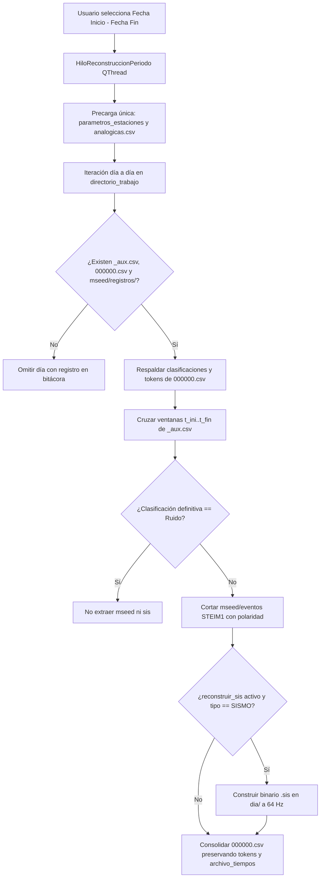

# `procesamiento/src/subprogramas/reconstruccion_eventos.py` — Contexto Técnico para Agentes IA

> Subprograma PyQt5 (`QMainWindow`) integrado en el menú **Ingreso de Datos** (Modo Período) para reconstruir masivamente eventos sísmicos (`.mseed` y opcionalmente `.sis`) a lo largo de un rango de fechas, cruzando las ventanas de tiempo de `AAAAMMDD_aux.csv` con la clasificación definitiva y tokens `EEEECBFFIISS` de `AAAAMMDD000000.csv`.

**Ruta**: `procesamiento/src/subprogramas/reconstruccion_eventos.py`  
**UI**: `procesamiento/src/ui/reconstruccion_eventos.ui`  
**Lenguaje**: Python 3.9 (PyQt5, ObsPy, SciPy)  
**Dependencias**: `rsa_procesamiento.reconstruir_eventos_dia`, `metodos_gestion.parametros_estaciones`, `rsa_io.lectura_archivo`  
**Proceso**: Invocado desde `programa_integrado.py` → Menú `Ingreso de Datos` → `Reconstrucción de eventos`.

---

## 1. Arquitectura y Flujo de Procesamiento

---

## 2. Contratos de Datos y E/S

* **Constructor**: `Reconstruccion_eventos(archivo, directorio_trabajo, responsable, horario, parent=None)`
* **Señales**: `cerrado = pyqtSignal()` emitida en `closeEvent` tras detener limpiamente el `QThread`.
* **Entradas por día**:
  * `AAAAMMDD_aux.csv`: ventanas `[t_inicio, t_final]` en columnas `4` y `5` (segundos desde `00:00:00`).
  * `AAAAMMDD000000.csv`: clasificación definitiva (`col 2`) y tokens `EEEECBFFIISS` (`col 3..103`).
  * `mseed/registros/*.mseed`: registros continuos de estaciones habilitadas.
* **Salidas**:
  * `mseed/eventos/EST_AAAAMMDD_hhmmss.mseed` (`STEIM1`, `reclen=512`).
  * `dia/AAAAMMDD_hhmmss.sis` (solo si `chk_reconstruir_sis` está marcado y la clasificación es `SISMO`).
  * `AAAAMMDD000000.csv` y `reportes/AAAAMMDD_tiempos.csv` actualizados sin perder reclasificaciones ni eventos exclusivos del CSV.

---

## 3. Componentes y Métodos Clave

| Clase / Método | Firma | Descripción |
|---|---|---|
| `HiloReconstruccionPeriodo` | `QThread` | Ejecuta el recorrido del período en segundo plano emitiendo `progreso_dia`, `progreso_evento`, `mensaje_bitacora` y `finalizado`. |
| `Reconstruccion_eventos.iniciar_reconstruccion` | `()` | Valida rango y directorio, bloquea controles y lanza el `QThread`. |
| `Reconstruccion_eventos.cancelar_reconstruccion` | `()` | Solicita cancelación cooperativa al finalizar el evento en curso. |
| `Reconstruccion_eventos.limpiar_estado` | `()` | Detiene y espera ordenadamente al hilo antes de cerrar la ventana. |

---

## 4. Decisiones de Diseño

1. **Opción `.sis` desactivada por defecto (`chk_reconstruir_sis`)**: las estaciones incorporadas posteriormente suelen ser digitales, por lo que omitir la síntesis binaria analógica `.sis` ahorra tiempo en períodos largos.
2. **Prioridad de clasificación de `AAAAMMDD000000.csv`**: siempre se memorizan primero las clasificaciones y tokens del CSV principal antes de recorrer `_aux.csv`.

---

## 5. Riesgos Técnicos

* En rangos de varios años con `chk_sobrescribir` activo, la reescritura de decenas de miles de `.mseed` puede tomar varios minutos; usar `chk_sobrescribir=False` cuando solo se desee completar estaciones faltantes.

---

## 6. Checklist de Verificación y Regresión

- [x] Compila limpiamente en Python 3.9 (`py_compile`).
- [x] Carga `reconstruccion_eventos.ui` sin errores en PyQt5.
- [x] Respeta reclasificaciones de `AAAAMMDD000000.csv` (`INDEFINIDO -> SISMO`, `SISMO -> Ruido`, `INDEFINIDO -> FF`).
- [x] Omite días sin `_aux.csv`, `000000.csv` o `mseed/registros/` sin detener el lote.
- [x] `chk_reconstruir_sis` inicia desmarcado por defecto.
