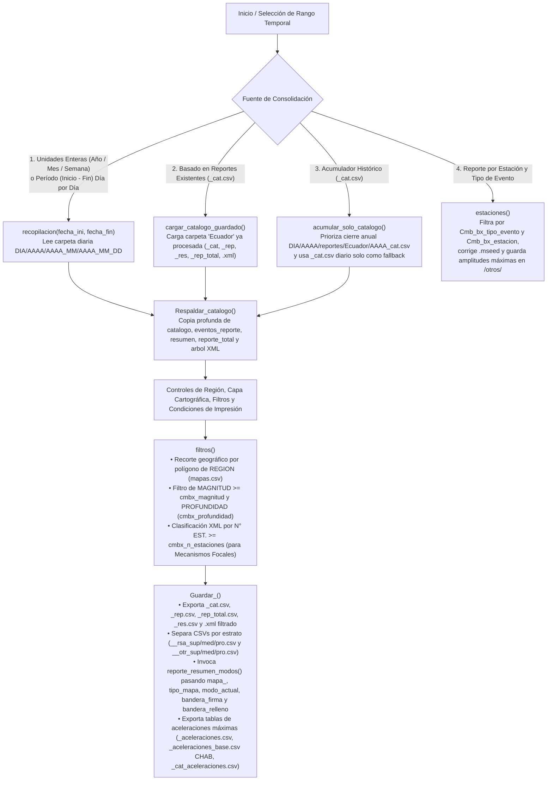

# `reporte_acumulado.py` — Contexto Técnico de Mantenimiento

> Subprograma de consolidación, filtrado espacio-temporal, clasificación para mecanismos focales, extracción de amplitudes por estación y generación de reportes acumulados (semanal, mensual, anual, por período o catálogo histórico) en formato PDF, CSV y XML para la Red Sísmica del Austro.

**Ruta**: [`src/subprogramas/reporte_acumulado.py`](file:///c:/Proyectos/rsa_sismologia/src/subprogramas/reporte_acumulado.py)  
**LOC**: 1082 | **Lenguaje**: Python 3.9+ | **Framework**: PyQt5, ObsPy, Matplotlib, ReportLab  
**Interfaz UI**: [`src/ui/reporte_mensual.ui`](file:///c:/Proyectos/rsa_sismologia/src/ui/reporte_mensual.ui)  
**Proceso**: Invocado desde `src/programa_integrado.py` (`Informes -> Reporte periodo`) o de forma independiente.

---

## 1. Arquitectura y Flujo de Procesamiento



---

## 2. Controles Críticos de la Interfaz y su Comportamiento Real en el Código

### 2.1. Casilla `Relleno` (`ck_box_relleno` &rarr; `bandera_relleno`)
- **Qué hace realmente**: Controla cómo se dibujan los **círculos que representan los sismos** sobre el mapa de portada (`dibujo_sismos_` en [`rsa_pdf_graficos.py`](file:///c:/Proyectos/rsa_sismologia/src/librerias/rsa_pdf_graficos.py#L243-L246)) y en los círculos de muestra de la leyenda (`caja_simbologia` en [`rsa_pdf_graficos.py`](file:///c:/Proyectos/rsa_sismologia/src/librerias/rsa_pdf_graficos.py#L340-L348)):
  - **Marcado (`bandera_relleno = True`)**: Dibuja círculos **rellenos con color sólido y opacidad 0.7** (`fillColor=color, fillOpacity=0.7, strokeWidth=0`). Es la presentación estándar para reportes semanales, mensuales o con baja/media densidad de epicentros.
  - **Desmarcado (`bandera_relleno = False`)**: Dibuja únicamente el **contorno/circunferencia hueca sin relleno interior** (`strokeColor=color, strokeWidth=0.2, fillOpacity=0.0`). Es indispensable cuando se grafican **catálogos históricos o multianuales** con cientos o miles de sismos superpuestos, evitando que el relleno sólido sature y oculte las trazas del mapa y los demás epicentros.
  - *(Excepción cartográfica)*: En el mapa `Fuentes` (`mapa_ == 3`, estilo `'halos_difuminados'`), cada epicentro se dibuja mediante 9 círculos azules concéntricos de opacidad decreciente (`0.1/k`), independientemente de `bandera_relleno`.

### 2.2. Selector `MAPA` (`cmbx_mapa` &rarr; `tipo_mapa` / `detalle` en `mapa_configuracion`)
- **Opciones en el combo**:
  `0: "1.Básico"`, `1: "1.Medio"`, `2: "3.Físico"`, `3: "4.Nidos"`, `4: "5.Fallas"`, `5: "6.Combinados"`.
- **Qué hace realmente**: En `Guardar_()`, se pasa `self.cmbx_mapa.currentIndex()` como parámetro `tipo_mapa` a `reporte_resumen_modos()`, el cual llama a `mapa_configuracion(mapa_, tipo_mapa)` en [`rsa_pdf_graficos.py`](file:///c:/Proyectos/rsa_sismologia/src/librerias/rsa_pdf_graficos.py#L486-L508):
  ```python
  nombre_mapa = os.path.join(ruta_datos, 'mapas', mapa_escogido[0] + '_' + str(detalle) + '.emf')
  ```
  Es decir, `cmbx_mapa` selecciona **qué capa temática vectorial `.emf`** de la región escogida se carga como fondo cartográfico en la portada del PDF:

| Índice en `cmbx_mapa` | Etiqueta UI | Sufijo de Archivo | Contenido Cartográfico del `.emf` | Disponibilidad en `datos/mapas/` |
| :---: | :--- | :---: | :--- | :--- |
| `0` | `1.Básico` | `<Region>_0.emf` | Mapa base limpio (contornos y límites básicos) | Todas las regiones (salvo `Hidronormandia` que inicia en `_1`) |
| `1` | `1.Medio` | `<Region>_1.emf` | Mapa intermedio (poblaciones, hidrografía y red vial base) | `Ecuador`, `Facultad`, `Fuentes`, `Reportes` y todos los proyectos/GADs |
| `2` | `3.Físico` | `<Region>_2.emf` | Mapa físico con relieve topográfico | `Facultad`, `Fuentes`, `Reportes` y todos los proyectos/GADs |
| `3` | `4.Nidos` | `<Region>_3.emf` | Mapa con zonificación de **nidos sísmicos / fuentes sismogénicas** | `Chanlud`, `Labrado`, `Huascachaca`, `Soldados`, `Ocana`, `Pichacay`, `Pichacay2`, `Tundayme` |
| `4` | `5.Fallas` | `<Region>_4.emf` | Mapa estructural con trazas de **fallas geológicas** | `Chanlud`, `Labrado`, `Soldados`, `Ocana`, `Pichacay`, `Pichacay2`, `Tundayme` |
| `5` | `6.Combinados` | `<Region>_5.emf` | Mapa combinado (relieve + fallas geológicas + nidos/infraestructura) | `Chanlud`, `Soldados`, `Ocana`, `Tundayme` |

> **Nota importante de validación**: Si se selecciona un índice de `MAPA` (por ejemplo `4.Nidos` o `5.Fallas`) para una `REGION` que solo tiene archivos `_0.emf`, `_1.emf` y `_2.emf` en `datos/mapas/`, `ReportLab` lanzará `FileNotFoundError` al intentar dibujar `<Region>_3.emf`.

### 2.3. Selector `N° EST. >` (`cmbx_n_estaciones` — Clasificación para Mecanismos Focales)
- **Opciones en el combo**: `"todos"`, `"4"`, `"5"`, `"6"`, `"7"`.
- **Propósito sismológico**: Mientras que para localizar un hipocentro bastan 3 estaciones, para calcular **mecanismos focales** (soluciones de plano de falla por polaridades de primeros arribos) se requiere un número mayor de estaciones con registro claro del evento (mínimo 4, 5, 6 o 7 estaciones).
- **Qué hace en el código (`filtros()`, líneas 728–798)**:
  - Recorre todos los nodos `<Evento>` del árbol XML acumulado (`self.raiz.findall('.//Evento')`).
  - Cuenta cuántas estaciones intervinieron en la caracterización del sismo:
    `registros = list(evento.iterfind("estaciones/estacion"))` &rarr; `numero_registros = len(registros)`.
  - Solo incorpora al nuevo árbol XML exportado (`self.nuevo_arbol` &rarr; `<nombre>.xml`) aquellos sismos que caen dentro del polígono de la `REGION`, cumplen `magnitud >= mag_` y tienen **`numero_registros >= n_est_`**.

### 2.4. Selector `REGION` (`cmbx_zona`) y Modos de Reporte (M0 – M7)
La elección de `REGION` en `cmbx_zona` (`datos/mapas/mapas.csv`) define tanto el recorte geográfico (`lat_min`, `lat_max`, `long_min`, `long_max`, `salto` y `estaciones`) como las banderas del reporte PDF a través de [`rsa_pdf_catalogo.py`](file:///c:/Proyectos/rsa_sismologia/src/librerias/rsa_pdf_catalogo.py):

| Modo | Constante | Zona en `cmbx_zona` | Descripción | Destinatario |
|---|---|---|---|---|
| **M0** | `MODO_MAPA_ESPECIAL` | `Region`, `Fuentes`, `Reportes` | Portada cartográfica especial (`Region`: círculos a mitad de radio `r = mag - 2.5`; `Fuentes`: halos azules difuminados; `Reportes`: control zonal) | Uso cartográfico / investigación |
| **M1** | `MODO_PERIODO_FRANJAS` | *(Generado en `procesamiento_integrado` / `reporte_diario`)* | Período por franjas horarias (`00–12`, `12–18`, `18–24`) | Control interno de turnos |
| **M2** | `MODO_DIARIO_REVISION` | *(Generado en `reporte_diario`)* | Diario de revisión con detalle y dummies locales | Auditoría interna de 24h |
| **M3** | `MODO_OFICIAL_DETALLADO` | `Ecuador` (`ck_box_reporte` marcado) | Boletín Oficial RSA detallado + horas por responsable + fichas individuales con cobertura 50/150 km, intentos, zoom P y todas las estaciones `.mseed` | Archivo técnico oficial RSA |
| **M4** | `MODO_OFICIAL_RESUMEN` | `Ecuador` (`ck_box_reporte` desmarcado) | Boletín Oficial RSA resumen (portada, estadística, horas de responsables y catálogo, sin hojas individuales) | Boletín ejecutivo RSA |
| **M5** | `MODO_FACULTAD_RESUMEN` | `Facultad` | Portada formato Facultad (`formato=2`), sismos en azul, simbología compacta, sin gráfico de barras y con tabla de catálogo | Decanato / Facultad / Difusión |
| **M6** | `MODO_INSTITUCIONAL_DETALLADO` | Proyectos/GADs (`>= 5`: `Chanlud`, `Labrado`, `Austro`, etc.) con `Reporte` marcado | Informe institucional detallado (filtra al polígono, gráfico de barras de sismos en la zona, catálogo zonal, firma opcional y detalle limpio solo con estaciones del proyecto + acelerogramas) | Entidades externas, GADs, ELECAUSTRO |
| **M7** | `MODO_INSTITUCIONAL_RESUMEN` | Proyectos/GADs (`>= 5`) con `Reporte` desmarcado | Informe institucional resumen (sin hojas de detalle de señales) | Entidades externas, GADs, ELECAUSTRO |

---

## 3. Algoritmos de Consolidación y Herramientas por Estación

### 3.1. Tres Vías de Carga del Período
1. **Día por Día (`recopilacion`)**: Invocada desde `anio_()`, `mes_()`, `semana_()` y `periodo()`. Recorre cada fecha del calendario e invoca `cargar_dia()`, acumulando `self.eventos`, `self.catalogo`, `self.eventos_reporte`, `self.resumen`, `self.reporte_total` y los nodos `<Evento>` en `self.raiz`.
2. **Carga de Reporte Existente (`cargar_catalogo_guardado`)**: Abre un `QFileDialog` sobre una carpeta llamada `Ecuador` y carga directamente los 5 archivos consolidados (`<base>_cat.csv`, `<base>_rep.csv`, `<base>_res.csv`, `<base>_rep_total.csv`, `<base>.xml`), deduciendo `fecha_ini` y `fecha_fin` del nombre del archivo. Permite generar de inmediato reportes derivados para cualquier otra `REGION` sin leer día por día.
3. **Acumulador Histórico Basado en `_cat.csv` (`acumular_solo_catalogo`)**: Recorre entre `dateEdit_ini_cat` y `dateEdit_fin_cat`. Para cada año `AAAA`, verifica primero si existe el cierre anual `DIA/AAAA/reportes/Ecuador/AAAA_cat.csv`; si existe, lo carga de un solo golpe y salta al `1 de enero` de `AAAA + 1`. Si no existe el archivo anual, lee día por día los archivos `DIA/AAAA/AAAA_MM/AAAA_MM_DD/AAMMDD000000_cat.csv`.

### 3.2. Dos Herramientas de Reporte por Estación
1. **Amplitudes Máximas por Estación y Tipo de Evento (`estaciones()`, líneas 594–665)**:
   - Filtra en el rango `dateEdit_ini` – `dateEdit_fin` los eventos cuyo tipo coincida con `Cmb_bx_tipo_evento` (`Ruido`, `FF`, `FC`, `TELESISMO`, `SISMO`, `INDEFINIDO`, `Evento_local`, `CONTROL`, `TODOS`) y donde la estación escogida en `Cmb_bx_estacion` tenga marca de aporte (`eventos[indice_ + 3][5] == '1'`).
   - Lee el archivo `.mseed` de esa estación, aplica `correccion(st[j], factor)` con el `FACTOR_MUL` de la estación, extrae la amplitud máxima absoluta de cada canal y guarda el archivo `reportes/otros/<CODIGO_ESTACION>_<TIPO_EVENTO>_rep.csv`.
2. **Selector Múltiple de Estaciones (`abrir_ventana_estaciones()` / `ejecutar_con_estaciones()`, líneas 82–175 y 996–1036)**:
   - Abre `VentanaEstaciones` (filtrable por `SISMICOS` y `ACELEROGRAFICOS`), y al pulsar `Ejecutar` busca para cada sismo de `self.catalogo` cuáles de las estaciones seleccionadas tienen registro (`evento[idx_estacion + 3] != "-"`), armando la lista `self.reporte` con los nombres de archivos `.mseed` involucrados por evento.

### 3.3. Salidas Generadas por `Guardar_()`
En la carpeta `<directorio_reporte>/<REGION>/`:
- `<nombre>_pdf1.pdf`: Boletín PDF generado por `reporte_resumen_modos()`.
- `<nombre>_cat.csv`, `<nombre>_rep.csv`, `<nombre>_rep_total.csv` y `<nombre>.xml` (filtrado por región, magnitud y `N° EST.`).
- Si la región usa `matriz_global` (`Region`, `Ecuador`, `Facultad`, `Fuentes`):
  - `<nombre>_res.csv`: Resumen estadístico diario con fila `Total:`.
  - 6 archivos CSV estratificados por profundidad y fuente para graficación externa (SIG):
    - `__rsa_sup.csv` (<40 km), `__rsa_med.csv` (40–70 km), `__rsa_pro.csv` (>70 km).
    - `__otr_sup.csv`, `__otr_med.csv`, `__otr_pro.csv` (otras redes).
- 3 archivos CSV de acelerógrafos (cuando el reporte incluye detalle de acelerogramas):
  - `<nombre>_aceleraciones.csv` (PGA, PGV y PGD de los 3 canales de todas las estaciones acelerográficas).
  - `<nombre>_aceleraciones_base.csv` (filtrado exclusivamente para la estación base `CHAB`).
  - `<nombre>_cat_aceleraciones.csv` (sub-catálogo de los sismos que activaron `CHAB`).

---

## 4. Organización por Zonas en `reporte_mensual.ui` e Inventario de Métodos

### 4.1. Distribución en 5 Zonas Funcionales (`src/ui/reporte_mensual.ui`)
1. **Zona 1 (`grupo_periodo_fuente` — Columna Izquierda Superior)**:
   - **A) `QButtonGroup` de Unidad de Período (`grupo_rb_periodo`)**: `rb_anio` (`comboBox_anio`), `rb_mes` (`comboBox_mes`), `rb_semana` (`comboBox_semana`) y `rb_periodo` (`dateEdit_ini` a `dateEdit_fin`). Habilita únicamente los selectores del radio elegido.
   - **B) `QButtonGroup` de Fuente de Consolidación (`grupo_rb_fuente`)**: `rb_fuente_catalogo` (**opción por defecto**, consolida en base al reporte ya emitido del período o por unidades básicas `_cat.csv` con `acumular_solo_catalogo`) y `rb_fuente_diaria` (segunda opción, recorre carpetas diarias completas con `recopilacion`, guardando en disco cada día con `Guardar_dia()` y propagando en cascada hacia semana, mes y año con `actualizar_periodos_emitidos_desde_fecha()`).
   - **Botones**: `btn_cargar_periodo` (`cargar_periodo_unificado()`) y `Btn_cargar_catalogo` (`cargar_catalogo_guardado()`).
2. **Zona 2 (`grupo_filtros_sismologicos` — Columna Central Superior)**:
   - Selectores cartográficos: `cmbx_zona` (`REGIÓN`) y `cmbx_mapa` (`MAPA`, capas `.emf` `0..5`).
   - Casilla maestra `ck_box_filtro`: Activa o desactiva la aplicación de filtros sismológicos sobre el catálogo y el XML.
   - **Filtro de Red / Origen (`cmbx_filtro_red`)**: Permite discriminar la procedencia de los eventos:
     * `0: "Solo Red Sísmica (RSA)"` (**opción por defecto y habitual**, garantiza que los boletines institucionales y resúmenes contengan exclusivamente la sismicidad de la RSA).
     * `1: "Todas las redes"` (incluye sismicidad local de la RSA y eventos de otras redes como IGEPN o USGS).
     * `2: "Solo Otras redes"` (discrimina eventos externos para estudios comparativos).
   - **Sub-grupo Profundidad (`grupo_filtro_prof`)**: `rb_prof_estratos` (`ck_prof_sup` <40 km, `ck_prof_med` 40–70 km, `ck_prof_pro` >70 km) vs `rb_prof_rango` (`spin_prof_min` a `spin_prof_max` en km).
   - **Sub-grupo Magnitud (`grupo_filtro_mag`)**: `rb_mag_todos` (`cmbx_magnitud`: `todos` o umbral `>=`) vs `rb_mag_rango` (`spin_mag_min` a `spin_mag_max` en Md).
   - **Sub-grupo N° Mínimo de Estaciones (`grupo_filtro_nest`)**: `cmbx_n_estaciones` (`todos`, `4`, `5`, `6`, `7`, `8`, `10`) y casilla `ck_nest_catalogo` (aplica el filtro de mínimo de estaciones para mecanismos focales tanto al catálogo/mapa PDF como al XML).
3. **Zona 3 (`grupo_reportes_estacion` — Columna Izquierda Media)**:
   - `Cmb_bx_tipo_evento` + `Cmb_bx_estacion` + `btn_estaciones` (`estaciones()`, exporta amplitudes máximas en `reportes/otros/`).
   - `btn_selector_estaciones` (`abrir_ventana_estaciones()` / `ejecutar_con_estaciones()`, consulta `.mseed` en el catálogo).
4. **Zona 4 (`grupo_impresion_pdf` — Columna Central Inferior) y Bitácora (`grupo_bitacora`)**:
   - Casillas `ck_box_reporte` (Detallado vs Resumen) y `ck_box_firma` (Firma institucional).
   - Grupo excluyente de 3 `QRadioButton` (`grupo_rb_simbologia`): `rb_circulos_rellenos` (opacidad 0.7), `rb_circulos_sin_relleno` (solo circunferencia hueca, opacidad 0.0) y `rb_circulos_concentricos` (9 círculos concéntricos difuminados e impresión exclusiva del mapa principal `M0` sin detalle adicional).
   - Etiqueta en vivo `lbl_resumen_impresion`, botones `Btn_guardar` y `Btn_Salir`, y panel de estado `textEdit`.
5. **Zona 5 (`grupo_vista_gis` — Columna Derecha de Vista Previa Cartográfica)**:
   - `contenedor_mapa_gis`: Contenedor nativo que aloja el lienzo interactivo `widget_grafico_mpl` (`FigureCanvasQTAgg`), mostrando el mapa base de Ecuador con límites provinciales y la sismicidad filtrada.
   - `ck_gis_estaciones`: Alterna la visualización de las estaciones sismológicas de la red como triángulos azules con etiqueta de código.
   - `lbl_resumen_gis`: Resumen cuantitativo en vivo del total de sismos representados desglosados por red (RSA vs Otras) y por estrato de profundidad.
   - `btn_actualizar_gis`: Redibuja manualmente la vista previa aplicando los filtros vigentes (`actualizar_vista_gis()`).
   - `btn_ampliar_gis`: Abre una ventana emergente redimensionable y maximizable (`abrir_ventana_emergente_gis()`) con su propio lienzo interactivo de alta resolución y barra de herramientas de navegación (`NavigationToolbar2QT`: zoom, desplazamiento, guardado) que se sincroniza en vivo al cambiar filtros.
   - `btn_exportar_gis`: Exporta el mapa actual a archivo PNG a 300 DPI (`exportar_imagen_gis()`).

### 4.2. Inventario de Métodos Clave en `Reporte_periodo`
| Método | Responsabilidad |
|---|---|
| `cargar_periodo_unificado()` | Punto de entrada único del botón `Cargar Período Seleccionado`; despacha según los `QRadioButton` de período y fuente. |
| `_obtener_rango_fechas_seleccionado()` | Calcula `(fecha_ini, fecha_fin)` exactos para Año, Mes, Semana ISO o Rango de Fechas. |
| `_cumple_filtro_profundidad(prof_km)` | Evalúa profundidad por estratos (`ck_prof_sup/med/pro`) o por rango numérico (`spin_prof_min..max`). |
| `_cumple_filtro_magnitud(mag)` | Evalúa magnitud por umbral (`cmbx_magnitud`) o por rango numérico (`spin_mag_min..max`). |
| `_cumple_filtro_red(fila_cat)` | Evalúa procedencia del sismo según `cmbx_filtro_red` (`Solo RSA`, `Todas las redes` o `Solo Otras redes`). |
| `_construir_mapa_conteo_estaciones()` | Cruza `self.raiz` (XML) y `self.eventos` (CSV diario) para contar cuántas estaciones caracterizaron cada sismo. |
| `filtros()` | Aplica recorte espacial de `REGION` y filtros de profundidad, magnitud y mínimo de estaciones tanto a `self.catalogo` como a `self.nuevo_arbol` (XML). |
| `actualizar_vista_gis()` | Renderiza en tiempo real el mapa GIS en `widget_mapa_gis` (y en `_widget_mapa_gis_emergente` si la ventana emergente está abierta) con `graficar_periodo_gis()`, sincronizando la simbología y estadísticas. |
| `abrir_ventana_emergente_gis()` | Crea o muestra una ventana independiente (`1050x800`, maximizable) con `NavigationToolbar2QT` para inspeccionar el mapa GIS a pantalla completa con zoom y paneo interactivo. |
| `exportar_imagen_gis()` | Guarda la figura cartográfica GIS activa como `<directorio_reporte>/<REGION>/<nombre>_gis.png` a 300 DPI. |
| `recopilacion(fecha_ini, fecha_fin)` | Procesa día por día con `cargar_dia()`, persiste en disco los archivos diarios mediante `Guardar_dia()`, propaga la cascada (`actualizar_periodos_emitidos_desde_fecha()`), acumula en memoria y refresca la vista GIS. |
| `acumular_solo_catalogo(...)` | Consolida rápidamente el catálogo descomponiendo el período en unidades básicas (`días -> semanas -> meses -> años -> meses -> semanas -> días`) mediante `generar_directorios_unidades_basicas(..., verificar_existencia=True, detallar=True)`. |

---

## 5. Riesgos Conocidos y Consideraciones de Mantenimiento

1. **Existencia de capas `.emf` según `cmbx_mapa`**: Los índices `3` (`4.Nidos`), `4` (`5.Fallas`) y `5` (`6.Combinados`) solo tienen archivos `.emf` físicos en `datos/mapas/` para las regiones de proyectos específicos (`Chanlud`, `Labrado`, `Huascachaca`, `Soldados`, `Ocana`, `Pichacay`, `Pichacay2`, `Tundayme`). En regiones generales como `Ecuador` (solo `_0` y `_1`) o `Region` (solo `_0`), se debe usar `1.Básico` (`0`) o validar con `os.path.exists` haciendo fallback a `_0.emf` para evitar un `FileNotFoundError`.
2. **Inicialización de atributos de fecha en `acumular_solo_catalogo()`**: Al acumular solo `_cat.csv`, se dejan inicializados `self.fecha_ini`, `self.fecha_fin`, `self.periodo_reporte` y `self.directorio_reporte` (respetando `tipo_forzado` de `_obtener_tipo_periodo_activo()`) para que `Guardar_()` opere de manera idéntica al escaneo día por día.
3. **Casilla `ck_box_filtro`**: En `filtros()`, `self.ck_box_filtro.isChecked()` gobierna la activación conjunta de los filtros de Profundidad (`_cumple_filtro_profundidad`), Magnitud (`_cumple_filtro_magnitud`) y N° Mínimo de Estaciones (`_construir_mapa_conteo_estaciones`).
4. **Estructura Unificada de Directorios de Guardado (`obtener_datos_reporte` + `Guardar_`)**:
   * **Año (`tipo_forzado=0`)**: `DIA/<AAAA>/reportes/<Región>/<AAAA>_pdf1.pdf` (`_cat.csv`, `_rep.csv`, `_res.csv`, `.xml`).
   * **Mes (`tipo_forzado=1`)**: `DIA/<AAAA>/<AAAA_MM>/reporte/<Región>/<Mes> del <AAAA>_pdf1.pdf`.
   * **Semana ISO (`tipo_forzado=2`)**: `DIA/<AAAA_fin>/reportes/semanal/semana<WW>/<Región>/Semana <WW>_pdf1.pdf`.
   * **Período / Rango de Fechas (`tipo_forzado=3`)**: Unificado siempre en `DIA/<AAAA_fin>/reportes/periodos/<AAAA_MM_DD_ini>_<AAAA_MM_DD_fin>/<Región>/<dd_mm_aaaa a dd_mm_aaaa>_pdf1.pdf` (sin importar si el rango está dentro del mismo mes, cruza meses o abarca varios años).

---

## 5. Checklist de Regresión

- [x] `ck_box_relleno` marcado dibuja círculos con relleno (`fillOpacity=0.7`) y desmarcado dibuja solo circunferencias huecas (`fillOpacity=0.0`, `strokeWidth=0.2`).
- [x] `cmbx_mapa` selecciona correctamente el archivo `<Region>_<indice>.emf` (`0` Básico a `5` Combinados) con *fallback* seguro si la capa especial no existe en disco.
- [x] `cmbx_n_estaciones` filtra el árbol XML exportado y el catálogo/mapa PDF (`ck_nest_catalogo`) conservando solo sismos con al menos `N` estaciones registradas (para mecanismos focales).
- [x] Al cambiar `cmbx_zona`, `cmbx_mapa`, `cmbx_magnitud`, `cmbx_n_estaciones` o los controles de profundidad/magnitud, `Cargar_catalogo()` restaura la copia íntegra desde `*_respaldo`, actualiza la ruta destino en la bitácora y rehabilita `Btn_guardar`.
- [x] Los reportes por rango de fechas (`rb_periodo`) se guardan siempre de manera unificada bajo `DIA/<AAAA_fin>/reportes/periodos/<AAAA_MM_DD_ini>_<AAAA_MM_DD_fin>/<Región>/`.
