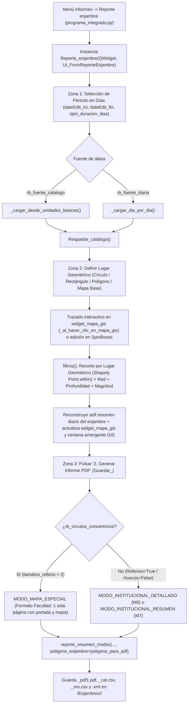

# Contexto Técnico: `src/subprogramas/reporte_enjambre.py`

> **Actualizado el**: 2026-04-20
> **Estado**: Activo (Subprograma `QWidget` integrado en `Informes -> Reporte enjambre` dentro de `src/programa_integrado.py`)

---

## 1. Propósito y Rol en la Arquitectura

[`reporte_enjambre.py`](file:///c:/Proyectos/rsa_sismologia/src/subprogramas/reporte_enjambre.py) (junto con su interfaz gráfica [`src/ui/reporte_enjambre.ui`](file:///c:/Proyectos/rsa_sismologia/src/ui/reporte_enjambre.ui)) implementa el módulo especializado de **Informes de Enjambres y Secuencias Sísmicas** de la Red Sísmica del Austro (RSA).

Proporciona un entorno de trabajo simplificado respecto a `Reporte_periodo` (`reporte_acumulado.py`), centrado exclusivamente en:
1. **Selección del período en días**: sincronización bidireccional entre `dateEdit_ini`, `dateEdit_fin` y `spin_duracion_dias` (duración inclusiva en días), con lectura desde **Unidades Básicas consolidadas (`_cat.csv`)** o **Día por día**.
2. **Delimitación del Lugar Geométrico (`lugar geométrico`) sobre el Mapa GIS**: aislamiento espacial del enjambre mediante **Círculo** (centro lat/lon y radio geodésico en km), **Rectángulo** (`lat_min/max`, `lon_min/max`), **Polígono libre** (vértices trazados con clics sobre el mapa GIS) o **Todo el Mapa Base**, además de filtros por red (`RSA`, `Todas`, `Otras redes`), rango de profundidad y magnitud mínima.
3. **Generación del Informe en PDF con ReportLab**: invocación directa de `reporte_resumen_modos()` en [`rsa_pdf_catalogo.py`](file:///c:/Proyectos/rsa_sismologia/src/librerias/rsa_pdf_catalogo.py), dibujando opcionalmente el contorno del lugar geométrico sobre el mapa `.emf` de portada (`dibujar_lugar_geometrico_pdf`) y respetando la regla de **1 sola página (formato Facultad)** cuando se selecciona **`Círculos concéntricos`**.
4. **Doble Modalidad Sismológica (`Enjambre Sísmico` vs. `Sismo Principal y Réplicas`)**: permite alternar entre graficar todos los sismos del clúster con simbología uniforme (`rb_modo_enjambre`) o destacar un **Sismo Principal** (`rb_modo_replicas`, automático por mayor magnitud o elegido en `cmbx_sismo_principal`) con la diana de **5 círculos concéntricos rojos del reporte de evento individual** sobre las réplicas, con opción de centrar el lugar geométrico en el sismo principal (`btn_centrar_en_principal`) y filtrar únicamente réplicas posteriores (`ck_solo_posteriores`, $t \ge t_{\text{principal}}$).

---

## 2. Diagrama de Flujo Operativo (Mermaid)

---

## 3. Contratos de Datos y Estructura del Lugar Geométrico

### 3.1. Diccionario `definicion_lugar` retornado por `_obtener_definicion_lugar_actual()`
Consumido tanto por `construir_poligono_lugar_geometrico()` / `graficar_periodo_gis()` en [`metodos_gis_rsa.py`](file:///c:/Proyectos/rsa_sismologia/src/librerias/metodos_gis_rsa.py) como por `dibujar_lugar_geometrico_pdf()` en [`rsa_pdf_graficos.py`](file:///c:/Proyectos/rsa_sismologia/src/librerias/rsa_pdf_graficos.py):
- **Círculo (`modo_lugar == 0`)**:
  `{'tipo': 'circulo', 'lat': float, 'lon': float, 'radio_km': float}`
- **Rectángulo (`modo_lugar == 1`)**:
  `{'tipo': 'rectangulo', 'lat_min': float, 'lat_max': float, 'lon_min': float, 'lon_max': float}`
- **Polígono libre (`modo_lugar == 2`)**:
  `{'tipo': 'poligono', 'vertices': [(lon_1, lat_1), (lon_2, lat_2), ...]}`
- **Todo el Mapa Base (`modo_lugar == 3`)**:
  `None` (aplica únicamente el recorte rectangular del mapa base `cmbx_zona`).

### 3.2. Estructura de `self.catalogo` y `self.resumen`
- `self.catalogo`: matriz estándar de 20 columnas (`IDX_INDICE=0` a `IDX_LUGAR=19`), idéntica a `reporte_acumulado.py`.
- `self.resumen`: reconstruida dinámicamente en `filtros()` día por día sobre el rango `[self.fecha_ini, self.fecha_fin]` exclusivamente con los sismos que caen dentro del lugar geométrico:
  - Si el mapa base usa `'vector_filtrado'` (proyectos/GADs como `Austro`, `Chanlud`, etc.): `[0, 0, sismos_dia_1, sismos_dia_2, ...]`.
  - Si el mapa base usa `'matriz_global'` (`Region`, `Ecuador`, `Facultad`, `Fuentes`): cabecera + fila `["Total:", total_sismos, 0, ...]` + filas diarias `[str(sismos_dia), "0", ...]`.

---

## 4. Inventario de Clases y Métodos Principales

| Símbolo | Tipo | Responsabilidad |
| :--- | :--- | :--- |
| `Reporte_enjambre` | Clase (`QWidget`) | Subprograma principal acoplable al `layout_contenedor` de `programa_integrado.py`. Emite la señal `cerrado = pyqtSignal()`. |
| `_al_cambiar_fechas_calendario` / `_al_cambiar_spin_duracion` | Métodos internos | Mantienen sincronizados `dateEdit_ini`, `dateEdit_fin` y `spin_duracion_dias` sin ciclos de señal (`_sincronizando_fechas`). |
| `cargar_sismicidad_periodo` | Método público | Carga el catálogo del rango de fechas (`_cargar_desde_unidades_basicas` o `_cargar_dia_por_dia`), crea el respaldo en memoria (`Respaldar_catalogo`) y habilita `Btn_guardar`. |
| `alternar_modo_dibujo_mapa` / `_al_hacer_clic_en_mapa_gis` | Métodos de interacción GIS | Capturan eventos `button_press_event` en el lienzo Matplotlib para trazar interactivamente un Círculo (2 clics: centro y borde con cálculo geodésico en km), Rectángulo (2 clics: esquinas opuestas) o Polígono libre (clics izquierdos añaden vértices; clic derecho cierra). |
| `filtros` | Método público | Filtra `self.catalogo` y `self.nuevo_arbol` (`.xml`) por recorte de mapa base, polígono Shapely del lugar geométrico (`poly_enjambre.contains(Point(lon, lat))`), red (`RSA` / `Todas` / `Otras`), profundidad y magnitud, y recalcula `self.resumen`. |
| `actualizar_vista_gis` | Método público | Renderiza en vivo los epicentros filtrados y el contorno del lugar geométrico en `self.widget_mapa_gis` y, si está abierta, en la ventana emergente `self._ventana_emergente_gis`. |
| `abrir_ventana_emergente_gis` | Método público | Abre una ventana independiente redimensionable (`1050x800`) con `NavigationToolbar2QT` para inspeccionar el mapa GIS del enjambre en pantalla amplia. |
| `Guardar_` | Método público | Exporta `_cat.csv`, `_res.csv`, `.xml` y genera `_pdf1.pdf` invocando `reporte_resumen_modos(..., poligono_enjambre=poligono_para_pdf)`. |
| `limpiar_estado` / `closeEvent` | Ciclo de vida Qt | Desconecta eventos de Matplotlib, cierra y destruye `_ventana_emergente_gis`, libera `widget_mapa_gis` y emite `self.cerrado.emit()`. |

---

## 5. Riesgos Conocidos e Invariantes

1. **Regla de Círculos Concéntricos (1 sola página)**: Cuando `rb_circulos_concentricos` está activo (`bandera_relleno == 2`), se deshabilitan `ck_box_reporte` y `ck_box_firma` y se invoca `MODO_MAPA_ESPECIAL`, el cual delega en `rsa_pdf_catalogo.py` el perfil de 1 sola página idéntico al informe de la **Facultad**.
2. **Liberación C++/Qt de Lienzos Matplotlib**: `limpiar_estado()` desconecta `_cid_click_gis` y destruye explícitamente tanto `widget_mapa_gis` como `_ventana_emergente_gis` para evitar fugas de memoria o referencias huérfanas al cambiar de subprograma en `programa_integrado.py`.

---

## 6. Checklist de Regresión

- [ ] Al abrir `Informes -> Reporte enjambre` en `programa_integrado.py`, el subprograma se monta limpiamente y muestra el mapa GIS base con el círculo inicial centrado en la región (`Austro`).
- [ ] Modificar `spin_duracion_dias` actualiza `dateEdit_fin` y viceversa sin bloqueos ni recursión infinita.
- [ ] Pulsar `Dibujar Lugar en el Mapa` permite trazar con el ratón un **Círculo** (2 clics), un **Rectángulo** (2 clics) o un **Polígono libre** (clics izquierdos + clic derecho) y filtra inmediatamente los sismos en pantalla.
- [ ] Pulsar `Ampliar Mapa` abre la ventana emergente GIS redimensionable con barra de navegación y el lugar geométrico dibujado.
- [ ] Pulsar `2. Generar Informe PDF` crea el archivo `_pdf1.pdf` en `<directorio_reporte>/Enjambres/<Zona>/` con el contorno del lugar geométrico en el mapa de portada; si está seleccionado `Círculos concéntricos`, genera únicamente la primera hoja con el formato de la Facultad.
